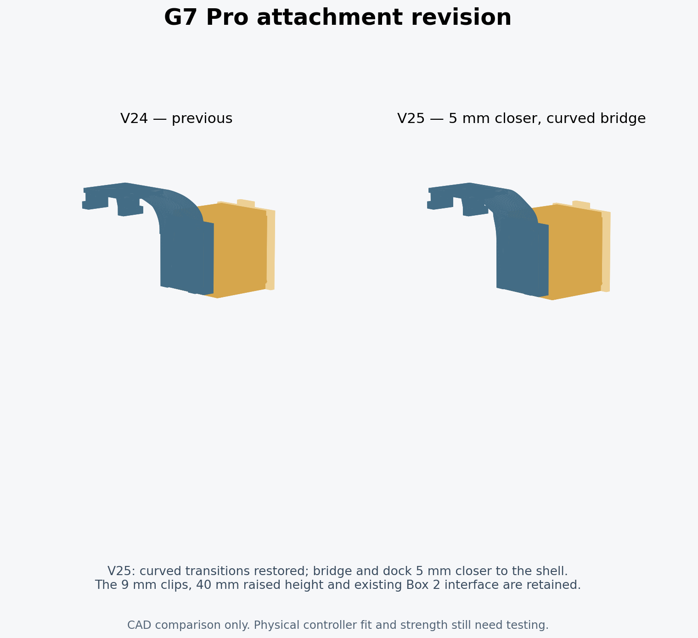

# GameSir G7 Pro modular reversible gyro mount

**V25 is the current revision:** the curved bridge and Box 2 dock sit **5 mm closer to the controller than V24**, with curved transitions based on V23. The **9 mm clips**, **40 mm raised height**, and **thin straight print supports** are retained.

The owner reported that V24 stuck out too far. V25 recesses the bridge and complete dock 5 mm toward the rear shell, while preserving the earlier clip and height corrections. The revised fit has not yet been physically tested; print the short hook coupon first.



## Download and print

- [Snapmaker U1 0.4 mm / Snapmaker PLA Black — supported V25 3MF](slicer/Snapmaker_U1_PLA_Black_0.4_V25/G7_Modular_v25_U1_0.4_Snapmaker_PLA_Black_Supported.3mf)
- [Editable, unsliced V25 project](slicer/Snapmaker_U1_PLA_Black_0.4_V25/G7_Modular_v25_U1_0.4_Snapmaker_PLA_Black.3mf)
- [Complete V25 ZIP](releases/G7_Pro_Modular_Reversible_Box2_V25_Complete.zip)
- [Revised attachment STL](printable/G7_Modular_v25_g7_mount.stl) and [9 mm hook test STL](printable/G7_Modular_v25_hook_fit_coupon.stl)

Open the 3MF **as a project** in Snapmaker Orca 2.4.1 or newer. The supported file includes cached toolpaths and supports; inspect them in Preview. Re-slice if you change anything.

Plate 1 contains the revised hook test, receiver, dovetail coupon and key. Plate 2 contains the complete four-part assembly. **The Box 2 enclosure, lid, key and dovetail profile are unchanged from V23**; reuse those prints if you already have them. To print only the revised attachment, select that object and re-slice rather than sending the cached full-plate job.

## Current geometry

- Trimmed 1 mm from the free ends of both top clips: 10 mm becomes 9 mm. No global scaling or thinning of their sides.
- Moved the complete dock/box/key installation 40 mm toward the controller top.
- Reduced the outward stand-off from V24’s 8 mm to 3 mm (5 mm closer). The V23-style upper curve eases inward above the unchanged clip root, preserving docking clearance. The straight structural links are replaced by curved links beneath the receiver floor.
- Removed the old long arms and lower dock, and joined the raised receiver with short structural arms.
- Used sparse straight rectilinear print supports (normal/snug, 3 mm line spacing), 0.32 mm separation and a sparse interface. No tree supports.

The structural arms are permanent parts of the attachment. The thin print supports shown in the slicer preview are removable. See [revision measurements and validation](docs/V25_REVISION.md) and [U1 setup details](slicer/Snapmaker_U1_PLA_Black_0.4_V25/README.md).

The controller shell, rear buttons, triggers and cable routes still need a physical check at this new position. Check the short hook first and then the complete mount without loading the device. PLA flexure durability and the strength of the bracket/key have not been physically verified.

## Files and history

V25 CAD is in [cad/G7_Pro_Modular_v25.scad](cad/G7_Pro_Modular_v25.scad); its seven STLs are in `printable/`, and both assembly views are in `assemblies/`. The V25 CAD reuses the frozen V24 9 mm clip geometry and V23 interface meshes. Its upper curved cheek is rebuilt from the V23 profile with a smooth inward transition; the controller-contact clip surfaces remain unchanged.

The complete original V22 ZIP and all 13 extracted files remain unchanged under `originals/`. V23 and V24 source, prints and projects are retained for history, including the [V23 instructions](docs/V23_README.md). **Use V25 filenames for this revision.** No license was supplied with the original files; this import does not assert ownership or grant a new license.

## Rebuild

Use the existing checkout; no Git worktree is needed. Requires OpenSCAD 2021.01 and Python 3.12:

```bash
python -m venv .venv
.venv/bin/python -m pip install -r tools/requirements.txt
source .venv/bin/activate
./tools/build.sh 25
```

The build exports all seven V25 meshes and runs the geometry/assembly checks, writing `docs/validation_v25.json`. Explicitly use `./tools/build.sh 23` to reproduce the old version.

To regenerate the U1 projects and validate the saved file in the actual slicer:

```bash
.venv/bin/python tools/create_snapmaker_orca_project.py --design-version 25 \
  --resources /path/to/SnapmakerOrca/resources \
  --orca /path/to/snapmaker-orca --workdir /tmp/g7-u1-v25 --validate
python tools/package_release.py --design-version 25
```

The saved V25 project passed 84 project/slicing checks, and the V25 geometry passed 94 CAD checks. These establish model and slicer consistency, not physical fit or a load rating.
