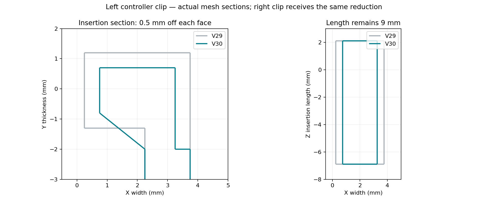

# GameSir G7 Pro modular reversible gyro mount

**V30 is current:** easier-release PETG supports and smaller controller insertion clips. The **9 mm clip length stays unchanged**. Only the insertion cross-section is reduced: **0.5 mm from each opposing face**, from 3.5 × 2.5 mm to **2.5 × 1.5 mm**. The V29 slider tilt and rounded bridge remain.



## Download and print

- [Supported V30 PETG 3MF](slicer/Snapmaker_U1_IEMAI_Matte_PETG_Black_0.4_V30/G7_Modular_v30_U1_0.4_IEMAI_Matte_PETG_Black_Supported.3mf)
- [Editable unsliced project](slicer/Snapmaker_U1_IEMAI_Matte_PETG_Black_0.4_V30/G7_Modular_v30_U1_0.4_IEMAI_Matte_PETG_Black.3mf)
- [Revised bracket STL](printable/G7_Modular_v30_g7_mount.stl) and [short clip test STL](printable/G7_Modular_v30_hook_fit_coupon.stl)
- [Complete V30 ZIP](releases/G7_Pro_Modular_Reversible_Box2_V30_Complete.zip)
- [Print settings and support-removal instructions](slicer/Snapmaker_U1_IEMAI_Matte_PETG_Black_0.4_V30/README.md)

Open the 3MF **as a project** in Snapmaker Orca 2.4.1 or newer. It is for a **Snapmaker U1, 0.4 mm nozzle, IEMAI matte PETG black 1.75 mm, top cover removed, textured PEI**. The supported project includes actual sliced toolpaths. Re-slice after changing settings or removing parts.

**Print plate 1 first** to check the smaller clips, sliding fit and support removal. Plate 2 contains the bracket, Box 2, lid and key. Only the bracket needs reprinting if you are reusing the existing box/lid/key. To print the bracket alone, remove other objects and re-slice.

## Changes and checks

The owner reported broken parts during support removal and excessive force inserting the clips. V30 keeps the clip length and center positions, reduces both cross-section dimensions, and joins the smaller tongues back to the retained roots. The receiver's lower edge remains tilted 5 mm inward from V28, with its upper edge fixed. Box, lid, key and mating profile shapes are unchanged.

Supports remain straight rectilinear normal/snug supports. V30 increases top/bottom separation from 0.32 to **0.48 mm**, increases XY clearance to **0.8 mm**, widens support lines from 3 to **4 mm spacing**, and removes dense top/bottom interfaces. The key uses the same easy-release separation. The overhang threshold is 45° and the brim gap increases to 0.3 mm. These choices reduce support contact and favor removal over underside finish. No tree branches are used.

**103 CAD checks and 99 project/slicing checks passed.** Both saved plates reopened and sliced in actual Snapmaker Orca with no plate-level warnings. These checks establish mesh dimensions, mating compatibility and saved settings, not physical fit, peel force or strength. Test the short clip first and do not force it into the controller. See [revision details](docs/V30_REVISION.md).

PETG temperatures remain a conservative starting point: **245°C nozzle, 80°C first-layer bed then 75°C**, limited to 4 mm³/s. This is derived from Snapmaker Generic PETG, not a manufacturer-validated IEMAI preset. Check your spool label. Let parts cool and support the clip roots while removing support in small sections.

## History and rebuild

The [V29 instructions](docs/V29_README.md), all earlier CAD/STLs/projects and the original V22 ZIP/files remain available. No license was supplied with the original files; this import does not grant a new license.

Requires OpenSCAD 2021.01 and Python 3.12:

```bash
python -m venv .venv
.venv/bin/python -m pip install -r tools/requirements.txt
source .venv/bin/activate
./tools/build.sh 30
.venv/bin/python tools/create_snapmaker_orca_project.py --design-version 30 \
  --resources /path/to/SnapmakerOrca/resources \
  --orca /path/to/snapmaker-orca --workdir /tmp/g7-u1-v30 --validate
python tools/package_release.py --design-version 30
```

Use the build script for the finished mount. It exports OpenSCAD components then joins them with manifold3d to avoid the CGAL failure with the rotated imported receiver. The V30 hook uses the frozen V29 hook as its base; all dependencies are in the ZIP. Validation reports include final STL and 3MF hashes.
