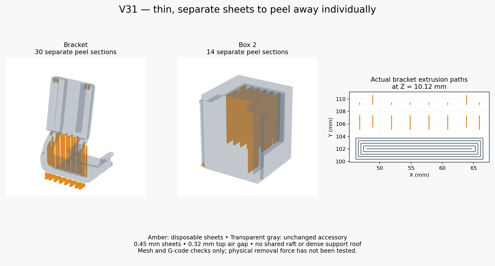

# GameSir G7 Pro modular reversible gyro mount

**V31 is current:** a completely new disposable support design using **separate 0.45 mm peel sheets**. The accessory itself is identical to V30, including the **9 mm clip length**, reduced **2.5 × 1.5 mm insertion cross-section**, rounded bridge and inward slider tilt.



## Download and print

- [Supported V31 PETG 3MF](slicer/Snapmaker_U1_IEMAI_Matte_PETG_Black_0.4_V31/G7_Modular_v31_U1_0.4_IEMAI_Matte_PETG_Black_Supported.3mf)
- [Editable unsliced V31 project](slicer/Snapmaker_U1_IEMAI_Matte_PETG_Black_0.4_V31/G7_Modular_v31_U1_0.4_IEMAI_Matte_PETG_Black.3mf)
- [Complete V31 ZIP](releases/G7_Pro_Modular_Reversible_Box2_V31_Complete.zip)
- [Print settings and removal instructions](slicer/Snapmaker_U1_IEMAI_Matte_PETG_Black_0.4_V31/README.md)

Open **as a project** in Snapmaker Orca 2.4.1 or newer. The setup remains **Snapmaker U1, 0.4 mm nozzle, IEMAI matte PETG black 1.75 mm, textured PEI, top cover removed**. **Print plate 1 first** to test the new sheets and clip fit. Plate 2 contains the complete bracket, box, lid and key. Reuse the existing box/lid/key if desired: remove their whole objects and re-slice to print only the bracket.

## New supports

The owner described the preferred Vader back-cover supports as thin layers that peeled away individually. Those source files were unavailable; V31 is a new design based on that description. It replaces V30's generated normal-support blocks with explicit disposable sheet geometry:

- Each sheet is 0.45 mm thick, targeting one extrusion with the 0.4 mm nozzle.
- Sheets are nominally 3 mm apart, with extra placement under the small clips.
- Long supports are split into sections at most 8 mm long, separated by 0.8 mm tear channels.
- A 0.32 mm geometric top air gap separates sheets from the accessory. Sheets starting on the accessory also have a 0.32 mm bottom gap.
- There is no shared raft or dense roof joining sheets. Bed-starting sheets have individual small feet.

The bracket has 30 disposable sections; Box 2 has 14. The hook test has 8; the male fit test and each key have 5 small support sections/pads. The lid and standalone receiver have none. Some sections are short pads rather than tall sheets.

These supports are **included as separate mesh shells inside each print object**. Keep them in position. Do not split the object, drop its shells individually onto the plate or enable automatic supports. Normal/manual mode is saved with no enforcers, so Orca does not add another set of support blocks. The ordinary support-density/gap fields do not control the explicit sheets. Use the supplied project; the ordinary accessory STL alone does not include these sheets.

Cool the part fully, hold it close to the sheet being removed, and peel each section separately. Do not lever a group against a clip. The permanent curved links remain part of the bracket. Thin supports and the air gap favor removal over supported-surface finish; sagging or roughness is possible. Actual peel force and physical print reliability still need testing.

## Verification and settings

All seven accessory STL files are byte-identical to V30. **110 CAD checks** passed. The saved project passed **131 project/slicing checks**, including unchanged accessory surfaces, separate sheet shells, no sheet/accessory overlap, actual single-bead sheet paths, native reload and both plates slicing with no plate-level warnings. The Supported file embeds those exact G-code files. See [revision details](docs/V31_REVISION.md).

PETG remains an uncalibrated Generic-PETG-derived starting profile: **245°C nozzle, 80°C first-layer bed then 75°C**, 4 mm³/s maximum flow, four walls, 0.16 mm layers. Check your IEMAI spool label; this is not a manufacturer-validated IEMAI preset. Physical fit, removal force, strength and fatigue are unverified.

## History and rebuild

[V30 instructions](docs/V30_README.md), prior revisions and the original V22 files/ZIP are retained. No license was supplied with the original files; this import does not grant a new license.

Requires OpenSCAD 2021.01 and Python 3.12:

```bash
python -m venv .venv
.venv/bin/python -m pip install -r tools/requirements.txt
source .venv/bin/activate
./tools/build.sh 31
.venv/bin/python tools/create_snapmaker_orca_project.py --design-version 31 \
  --resources /path/to/SnapmakerOrca/resources \
  --orca /path/to/snapmaker-orca --workdir /tmp/g7-u1-v31 --validate
python tools/package_release.py --design-version 31
```

The V31 build copies the frozen V30 accessory meshes and checks them. `tools/peel_sheets.py` creates the disposable sheets from the oriented geometry during project generation. Meshes, support-source STLs, placement manifest, JSON presets, validation reports and rebuild tools are included in the ZIP.
