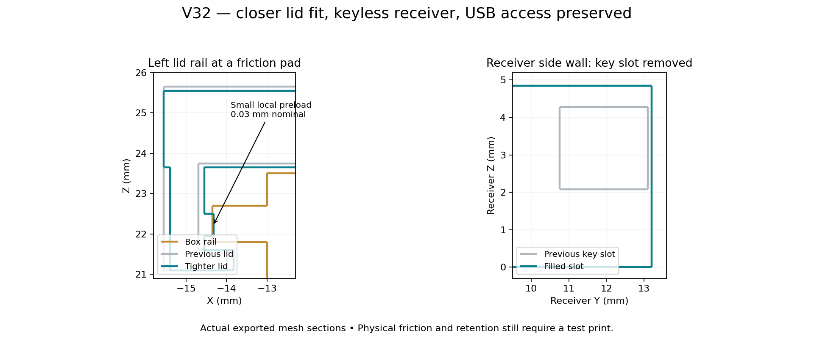

# GameSir G7 Pro modular reversible gyro mount

**V32 is current:** a closer-fitting Box 2 sliding lid with small friction pads, plus a **keyless receiver**. The locking key is omitted from both print plates and its receiver slot is filled. The V30 controller clips and V31 thin peel-sheet support design are retained.



## Download and print

- [Supported V32 Snapmaker PLA Black 3MF](slicer/Snapmaker_U1_PLA_Black_0.4_V32/G7_Modular_v32_U1_0.4_Snapmaker_PLA_Black_Supported.3mf) and [PLA setup instructions](slicer/Snapmaker_U1_PLA_Black_0.4_V32/README.md)
- [Supported V32 PETG 3MF](slicer/Snapmaker_U1_IEMAI_Matte_PETG_Black_0.4_V32/G7_Modular_v32_U1_0.4_IEMAI_Matte_PETG_Black_Supported.3mf)
- [Editable unsliced project](slicer/Snapmaker_U1_IEMAI_Matte_PETG_Black_0.4_V32/G7_Modular_v32_U1_0.4_IEMAI_Matte_PETG_Black.3mf)
- [Tighter lid STL](printable/G7_Modular_v32_lid.stl)
- [Keyless bracket STL](printable/G7_Modular_v32_g7_mount.stl)
- [Complete V32 ZIP including PLA and PETG](releases/G7_Pro_Modular_Reversible_Box2_V32_Complete_PLA.zip)
- [Print settings and instructions](slicer/Snapmaker_U1_IEMAI_Matte_PETG_Black_0.4_V32/README.md)

Open **as a project** in Snapmaker Orca 2.4.1 or newer. Choose the material-specific project: **Snapmaker PLA Basic Black** or **IEMAI matte PETG black**, both for **U1, 0.4 mm nozzle, 1.75 mm filament, textured PEI, top cover removed**. The PLA setup uses the official Snapmaker PLA Basic preset at **220°C nozzle / 65°C bed**, with PLA cooling and an 8 mm³/s flow cap. Geometry and sheet supports are the same in both material variants. Thin disposable sheets are already positioned inside the print objects. Keep the shells together; do not add automatic supports. Re-slice after removing whole objects or changing settings.

Plate 1 has the hook test, keyless receiver and male docking coupon. Plate 2 has the keyless bracket, existing Box 2 and tighter lid. **No key is printed.** To test only the new lid against your existing Box 2, remove the other whole objects on plate 2 and re-slice. Box 2 itself is unchanged and can be reused. Reprint the bracket if you want its former key slot filled.

## Fit changes and clarification

The lid side walls and capture lips move inward 0.15 mm per side, reducing nominal rail-side clearance from 0.35 to 0.20 mm. Its roof moves down 0.10 mm, reducing clearance above the box rim from 0.25 to 0.15 mm. Six small ramped pads add approximately 0.03 mm of local preload against the rails. This is a modest starting fit, not a measured holding force.

The separate key actually locked the **whole box onto the controller receiver**, not the lid. V32 fills that slot in the bracket and standalone receiver without changing the sliding channel. **The large matching cutouts in the box and lid are USB access, and are retained.** The two small lid-side reliefs are snap-detent clearance, not key holes; they remain functional.

Removing the key leaves the controller docking connection relying on its existing sliding friction. A tighter lid does not secure the whole box to the controller. Test that keyless connection unloaded before relying on it. This revision does not establish friction retention, strength or fatigue life. Existing positive-lock instructions apply only to older keyed revisions.

## Verification

**82 CAD checks** passed: connected watertight parts, filled key-slot side walls, six-part inventory, both box orientations and insertion paths, lid motion with intentional contact confined to the small friction pads and existing detents. **110 native project/slicing checks** passed for each material variant; both saved plates in each project reopened and sliced without plate-level warnings. The Supported file contains the verified G-code and thin-sheet paths. See [V32 details](docs/V32_REVISION.md).

PETG remains an uncalibrated Generic-PETG-derived starting profile: 245°C nozzle, 80°C bed initially then 75°C, 4 mm³/s maximum flow. Check your IEMAI spool label. Let parts cool before testing or peeling support sheets individually; do not force a binding lid or clip.

## History and rebuild

[V31 instructions](docs/V31_README.md), earlier keyed parts/projects and the original V22 files remain for history. No license was supplied with the original files; this import does not grant a new license.

Requires OpenSCAD 2021.01 and Python 3.12:

```bash
python -m venv .venv
.venv/bin/python -m pip install -r tools/requirements.txt
source .venv/bin/activate
./tools/build.sh 32
.venv/bin/python tools/create_snapmaker_orca_project.py --design-version 32 --material pla \
  --resources /path/to/SnapmakerOrca/resources \
  --orca /path/to/snapmaker-orca --workdir /tmp/g7-u1-v32-pla --validate
python tools/package_release.py --design-version 32 --material pla
```

`tools/build_v32.py` exports the parametric lid and slot-fill patch from CAD, then uses manifold3d for robust unions. Receiver coordinates are canonicalized to 0.00001 mm before union to avoid degenerate float32 triangles. Six STLs, assemblies, profiles, support-source meshes, validation reports and rebuild tools are included in the ZIP. Historical key files are retained, but the V32 project has no key.
