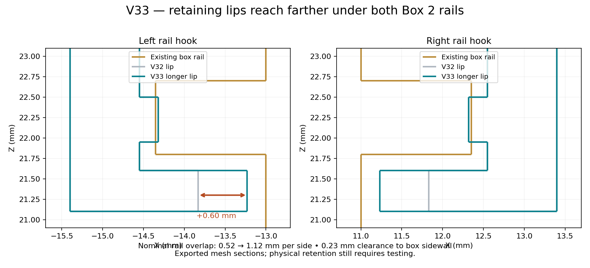

# GameSir G7 Pro modular reversible gyro mount

**V33 is current:** the Box 2 cap has **0.60 mm longer retaining lips on both sides**. Their reach increases from 0.72 to 1.32 mm, increasing nominal overlap beneath each box rail from **0.52 to 1.12 mm**. The existing box can be reused; **only the cap needs reprinting**.



## Download and print

- [Supported V33 Snapmaker PLA Black 3MF](slicer/Snapmaker_U1_PLA_Black_0.4_V33/G7_Modular_v33_U1_0.4_Snapmaker_PLA_Black_Supported.3mf)
- [Editable unsliced PLA project](slicer/Snapmaker_U1_PLA_Black_0.4_V33/G7_Modular_v33_U1_0.4_Snapmaker_PLA_Black.3mf)
- [New cap STL](printable/G7_Modular_v33_lid.stl)
- [Complete V33 ZIP](releases/G7_Pro_Modular_Reversible_Box2_V33_Complete_PLA.zip)
- [Print instructions](slicer/Snapmaker_U1_PLA_Black_0.4_V33/README.md) and [revision measurements](docs/V33_REVISION.md)

Open the 3MF **as a project** in Snapmaker Orca 2.4.1 or newer. It is set up for **Snapmaker U1, 0.4 mm nozzle, Snapmaker PLA Basic Black 1.75 mm, textured PEI, top cover removed** at **220°C nozzle / 65°C bed**. Thin peel-sheet supports are included. Keep each object's shells together and retain Normal/manual mode; do not add automatic support blocks.

**To print only the new cap:** remove the bracket and box objects from plate 2, keep the whole lid object including its disposable support sheets, and **re-slice**. The cached toolpaths in the download describe the complete saved plate. The ordinary cap STL has no support sheets; use the project for the prepared setup.

## What changed

The cap's inward-facing return lips reach farther under the rails, improving geometric capture against lifting off. The body-sidewall clearance remains 0.23 mm at each new lip tip; the existing vertical rail gap is retained. Eight thin disposable support sections beneath the longer lips help print their undersides. Let the cap cool before peeling each sheet separately; hold the nearby wall rather than levering against it.

The V32 friction pads, wall spacing, roof position, USB notch and snap-detent reliefs remain. The controller attachment, keyless receiver, box and fit coupons are byte-identical to V32. Clip insertion length remains 9 mm. The controller dock still relies on its existing sliding friction; this cap change does not add a controller docking lock.

**90 CAD checks and 112 native project/slicing checks passed.** Checks cover the longer lip tips, unchanged other parts, the sliding path, deliberate outward-lift contact with the rails, valid meshes and actual thin-sheet paths. Both saved PLA plates reopened and sliced without plate-level warnings. CAD engagement is not a physical retention-force measurement: test the cooled cap on the existing box before use and do not force it if it binds.

## History and rebuild

[V32 instructions](docs/V32_README.md), earlier geometry and both previous material setups remain available. V33's prepared project uses PLA. The original V22 files and ZIP are retained. No license was supplied with those files; this import does not grant a new license.

Requires OpenSCAD 2021.01 and Python 3.12:

```bash
python -m venv .venv
.venv/bin/python -m pip install -r tools/requirements.txt
source .venv/bin/activate
./tools/build.sh 33
.venv/bin/python tools/create_snapmaker_orca_project.py --design-version 33 --material pla \
  --resources /path/to/SnapmakerOrca/resources \
  --orca /path/to/snapmaker-orca --workdir /tmp/g7-u1-v33-pla --validate
python tools/package_release.py --design-version 33 --material pla
```

The build copies the five unchanged V32 parts and exports the new parametric cap. V33 defaults to PLA; V29–V32 retain their legacy PETG default. Profiles, support-source meshes, validation reports, source and rebuild tools are in the ZIP.
