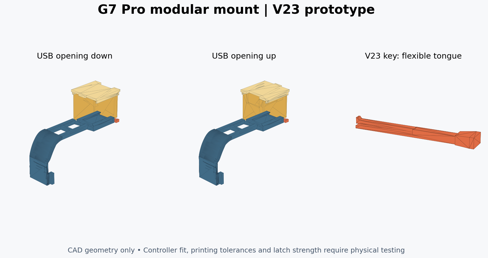

# GameSir G7 Pro modular reversible gyro mount

**V23 is a CAD-checked prototype. Physical fit on a G7 Pro has not been verified.**
The owner has not printed the hook; the supplied archive has no measured controller model or dimensions for the device inside Box 2. Controller grip, button/trigger clearance, cable clearance, charging-dock clearance, device fit, and load strength still need testing. Do not treat the filenames or the original instructions as proof of fit.

This repository preserves the complete supplied V22 package and adds a self-contained V23 repair. The box can be reversed 180° to point its USB opening up or down. Original controller-contact surfaces, box cavity and sliding lid remain unchanged because there is no dimensional evidence supporting a change to them.



Download the [complete V23 ZIP](releases/G7_Pro_Modular_Reversible_Box2_V23_Complete.zip) for all corrected files and preserved originals.

## Snapmaker U1 print project

For a U1 with a 0.4 mm nozzle and regular Snapmaker black PLA, use the [configured two-plate Snapmaker Orca 3MF](slicer/Snapmaker_U1_PLA_Black_0.4/G7_Modular_v23_U1_0.4_Snapmaker_PLA_Black_Supported.3mf). It contains fit tests and the four production parts with material/process settings, revised orientations, and actual sliced support toolpaths. An editable unsliced companion is included alongside it. [Setup details and estimates](slicer/Snapmaker_U1_PLA_Black_0.4/README.md). Open as a project, review the preview and print the fit-test plate first.

## Start with the fit tests

1. Print `printable/G7_Modular_v23_hook_fit_coupon.stl` first. It preserves the full hook width/contact surfaces but omits the long arms and dock. Fit it gently on the controller; it must seat without forcing, scratching, or contacting buttons. **This coupon is not a load-bearing mount.**
2. Print `G7_Modular_v23_universal_receiver.stl`, `G7_Modular_v23_male_fit_coupon.stl`, and `G7_Modular_v23_lock_key.stl`. Test sliding, end stop, key insertion and release using the same material/settings as the final print. The key has a small flexible tongue; check that the 0.40 mm gap has not fused. Press the exposed tongue toward the solid lower bar to release it, then pull the grip. Never force a stuck latch.
3. Only after those pass, print the full mount, box and lid and check the complete controller installation path, rear buttons, triggers, cable bends, and your gyro device. The short hook coupon does not test the long arms against the controller body.
4. Keep the controller supported while checking retention. Test with an empty box before adding the device. Record interference locations and measured gaps before changing controller-facing geometry.

PETG is a reasonable starting material for the flexible key. Suggested starting settings are 0.20 mm layers and 4–5 perimeters; these are not validated process settings. The configured U1 project turns the key onto its long side with removable supports, keeping the flex gap vertical. Slicing the key flat leaves an unsupported 13 mm tongue; use the supplied orientation and inspect/remove supports carefully. If the gap fuses or the tongue cracks, stop and adjust the process/design. The main mount and box may need supports. Review every orientation and overhang in the slicer.

## Files

| Location | Contents |
| --- | --- |
| `printable/` | Seven V23 STLs, in millimeters |
| `assemblies/` | USB-up/down assembly views plus a separated seven-object 3MF |
| `cad/G7_Pro_Modular_v23.scad` | Self-contained V23 source, with local reference meshes |
| `cad/reference/` | Exact supplied V22 mount, box and lid used as mesh-backed geometry |
| `originals/` | Untouched original ZIP and all 13 extracted V22 files, including preview, GLB and 3MFs |
| `docs/` | Changes, test results, and physical fit checklist |
| `tools/` | Rebuild, mesh checks and 3MF packaging |

The assembly 3MFs are **viewing references, not files to slice assembled**. The separated 3MF puts each object on Z=0 with a 12 mm gap; it does not include printer profiles, support settings or a guarantee that the layout fits your printer. Import/rearrange individual objects as needed.

## What changed in V23

- Added a positive stop at installed Y=51.4 mm. V22 let the enclosure reach a support arm before the dovetail reached its intended stop. V23 limits inward travel to 0.2 mm from the reference assembled pose.
- Lowered the transverse key slot and key by 0.4 mm, increasing the receiver roof from 0.17 to 0.57 mm.
- Replaced the key's solid snap bump with a dedicated cantilever tongue and release gap. It is still an untested printed flexure; CAD checks do not establish fatigue life or holding force.
- Made the source rebuildable using included meshes. V22 referenced `gamesir-dongle-holder.stl` and `Box 2(1).stl`, neither of which was supplied. V23 preserves those already-exported shapes instead of guessing their missing originals. The hook and cavity are mesh-backed, not reconstructed parametric surfaces.
- Added a short hook-fit coupon, regenerated matching assemblies, and added reproducible geometric checks.

See [engineering review](docs/ENGINEERING_REVIEW.md) and [machine-readable results](docs/validation.json). V22 and V23 use the same dovetail profile and box; use the V23 receiver and V23 key together. Do not assume the revised key is validated in a V22 receiver.

## Assembly

With the key removed, slide the box dovetail into the open receiver end (installed +Y, controller-bottom side) toward the closed stop. The lid faces outward. Insert the key from the grip side, checking that the tongue returns and the key blocks withdrawal. To reverse USB orientation, remove the key, slide the entire box and lid free, rotate both together by 180° about the outward-facing axis and reinstall. Open the lid by sliding toward negative **local** box Y; this direction rotates with the box. The existing lid has snap detents that require a physical fit test.

The standalone receiver is an interface component for future adapters; it is not itself a mount for another controller.

## Rebuild and validate

Use the existing checkout; no Git worktree is needed. Tested with OpenSCAD 2021.01 and Python 3.12 on Linux:

```bash
python -m venv .venv
.venv/bin/python -m pip install -r tools/requirements.txt
source .venv/bin/activate
./tools/build.sh
```

The build exports all seven STLs with OpenSCAD warnings treated as errors, checks solids and both assembly orientations, samples insertion paths every 0.25 mm, checks stop/key retention geometry, distinguishes intentional snap interference, checks preservation of supplied surfaces, and writes matching 3MFs and `docs/validation.json`. It fails on unexpected interference or invalid meshes. These are CAD tests, not a controller fit test or a strength simulation.

`dock_extra_x` (0–0.5 mm per side) in the SCAD source can widen the female dock for a tight print. Default is zero. Rebuild the receiver/mount and repeat the fit tests after changing it. Do not scale the whole model to adjust the dovetail: that also changes the controller hook and device cavity.

No license was supplied with the original archive; this import does not assert ownership or grant a new license.
