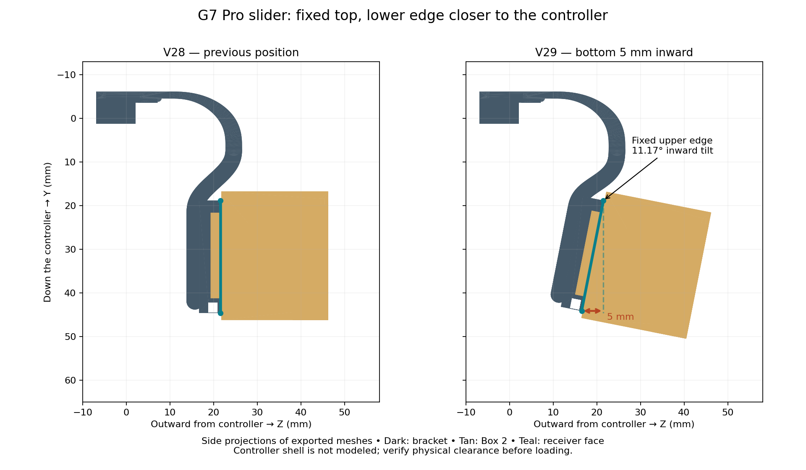

# GameSir G7 Pro modular reversible gyro mount

**V29 is current:** the slider pivots at its upper edge, bringing its bottom **5 mm closer to the controller** (11.17°). The rounded bridge and 9 mm clips remain. This release includes a **Snapmaker U1, 0.4 mm, open-top IEMAI matte PETG black 1.75 mm** starting setup with thin straight supports.



## Download and print

- [Supported V29 PETG 3MF](slicer/Snapmaker_U1_IEMAI_Matte_PETG_Black_0.4_V29/G7_Modular_v29_U1_0.4_IEMAI_Matte_PETG_Black_Supported.3mf)
- [Editable unsliced V29 PETG project](slicer/Snapmaker_U1_IEMAI_Matte_PETG_Black_0.4_V29/G7_Modular_v29_U1_0.4_IEMAI_Matte_PETG_Black.3mf)
- [Revised bracket STL](printable/G7_Modular_v29_g7_mount.stl)
- [Complete V29 ZIP](releases/G7_Pro_Modular_Reversible_Box2_V29_Complete.zip)
- [Filament, support and printing instructions](slicer/Snapmaker_U1_IEMAI_Matte_PETG_Black_0.4_V29/README.md)

Open the 3MF **as a project** in Snapmaker Orca 2.4.1 or newer. Check the U1/0.4 mm machine selection and PETG preset, then review Preview. The supported project includes actual sliced support toolpaths. Re-slice after changing settings or deleting parts.

Plate 1 has the hook test, receiver, male fit coupon and key. Plate 2 has the full bracket, Box 2, lid and key. If you already have Box 2, its lid and key, **only the bracket needs reprinting**: their shapes are unchanged. Select the bracket and re-slice to print it alone. The standalone receiver on plate 1 is a fit test, not an additional piece required by the integral bracket.

## Geometry and verification

The complete receiver rotates rigidly around its upper face edge. Its lower face moves inward 5 mm; the main clip stays fixed. The supporting links curve into the new inclined receiver. The box and key follow the same tilt, preserving their mating geometry and both USB orientations. The upper slider edge keeps the previous 5 mm inset; the lower edge is now 10 mm inside that same main-base reference. See [V29 measurements](docs/V29_REVISION.md).

The exported models passed **99 CAD checks**, including the 5 mm movement, unchanged clips, both assemblies and full sliding insertion paths. Both saved PETG plates reopened and sliced without plate warnings; **92 project/slicing checks** passed. These checks do not establish physical shell clearance or strength. The photo shows the desired direction but provides no scale or full controller model. Test the unloaded bracket against the shell, buttons and cables before installing the device.

PETG settings are a conservative starting profile derived from the official Snapmaker Generic PETG preset, **not a manufacturer-validated IEMAI profile**. Confirm the temperatures against your spool label. No physical PETG print, flow calibration, latch fatigue or load test has been performed.

## Files and rebuild

Prior revisions, PLA projects and original V22 files are retained. [V28 instructions](docs/V28_README.md) describe the previous position. The original ZIP and all 13 extracted files remain under `originals/`. No license was supplied with the original files; this import does not grant a new license.

Requires OpenSCAD 2021.01 and Python 3.12:

```bash
python -m venv .venv
.venv/bin/python -m pip install -r tools/requirements.txt
source .venv/bin/activate
./tools/build.sh 29
.venv/bin/python tools/create_snapmaker_orca_project.py --design-version 29 \
  --resources /path/to/SnapmakerOrca/resources \
  --orca /path/to/snapmaker-orca --workdir /tmp/g7-u1-v29 --validate
python tools/package_release.py --design-version 29
```

V29 exports bracket components through OpenSCAD, then joins them with manifold3d: CGAL in OpenSCAD 2021.01 fails to union the rotated imported receiver reliably. Use the build script for the finished bracket, rather than directly exporting the full mount from SCAD. Other parts export directly. The seven STLs, assembly views, validation reports, profile JSONs and reproducible tools are included in the ZIP.
