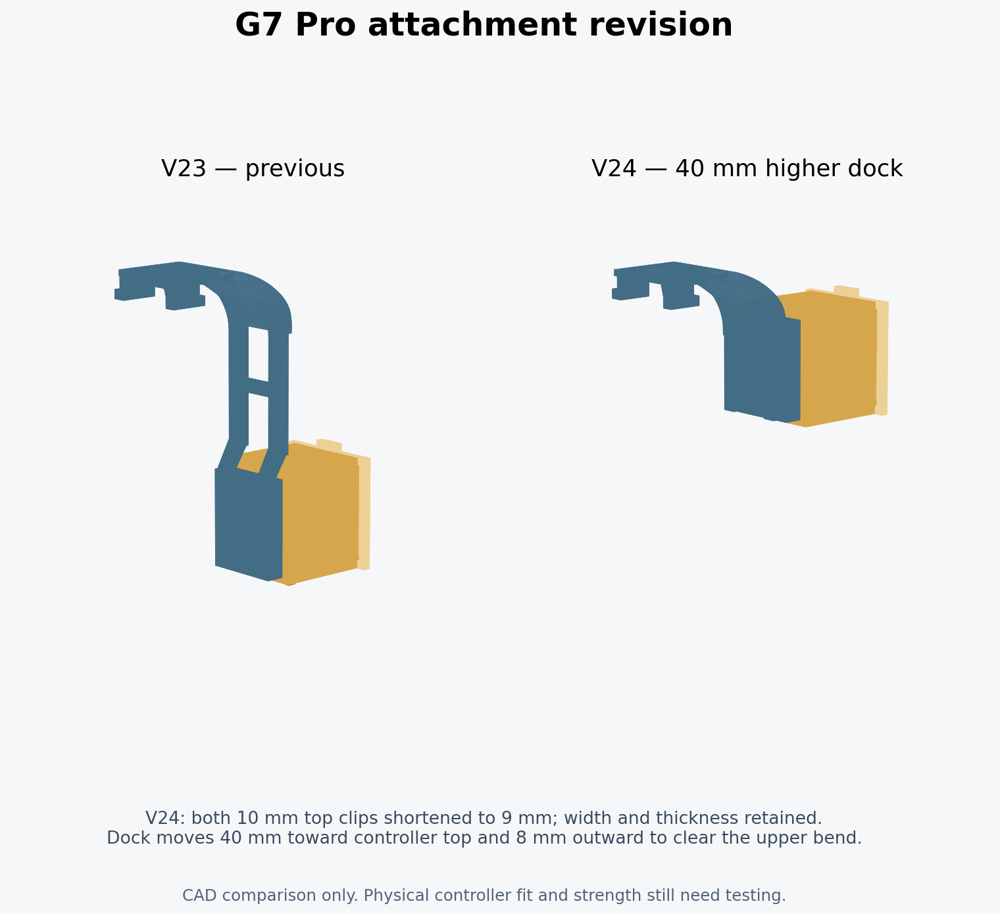

# V24: shorter clips and dock raised 40 mm

The owner's final clarification was that the **two clips on the controller top were 10 mm long**, their sides fit, and they should be **1 mm shorter**. This supersedes the earlier provisional suggestions to thin them or shorten them 2 mm. V24 trims their free ends to 9 mm without scaling or reducing their side widths/thicknesses. Only the new 9 mm hook test is supplied; the earlier suggested length variants were not needed after this clarification.

## Measured geometry changes

Coordinate convention: +Y points toward the controller bottom; +Z points outward from the controller. All dimensions are mm.

| Measurement | V23 | V24 |
| --- | --- | --- |
| Clip length at each cheek (X=2.5 and X=20.5 sections) | 10.0 | 9.0 |
| Clip tip Z | -7.9 | -6.9 |
| End of dock at +Y | 74.6 | 34.6 |
| Receiver center reference Y | 61.4 | 21.4 |
| Receiver base Z | 23.7 | 31.7 |
| Native box placement | [12.5, 64.2, 29.8] | [12.5, 24.2, 37.8] |
| Box reversal axis XY | [11.5, 61.4] | [11.5, 21.4] |

This is exactly a **40 mm upward translation** plus **8 mm outward stand-off** of the receiver, box, lid and key in the installed frame. Moving only upward puts the raised module next to the upper bend. The outward offset preserves that bend and its hook attachment while keeping the male dovetail and enclosure clear. The closest bounding-plane clearance between the male head and retained bend is about 2.83 mm; the enclosure rear face has about 5.28 mm clearance. These refer to the CAD bracket, not the unmodeled controller shell.

The original long arms and lower receiver are cropped away. Two short permanent 3.7 mm-wide structural links join the retained upper bend to the raised socket. Their tops stay below the channel floor, so they cannot obstruct the dovetail or key slot. They are not disposable print supports.

## Compatibility and checks

The box, lid, key, male coupon and standalone receiver are geometrically unchanged from V23. Existing V23 printed Box 2 components can therefore be reused with the new attachment. The native female channel, stop, key slot and 0.57 mm roof remain the same; only the complete interface's installed location changes.

`tools/package_and_validate.py --design-version 24` passed **92 CAD checks**. They test watertight connected solids, both 9 mm clip lengths, unchanged clip surfaces above the tip trim, the 40 mm dock translation, interface preservation, both USB orientations, insertion/removal paths, stop/key retention geometry and the assembly 3MF round trips. Measurements of the receiver floor are restricted to the receiver itself so the reinforcing structural arms beneath it are not incorrectly counted as interface-floor material. Direct mesh-difference volumes are used for receiver agreement to avoid cancellation error in subtracting nearly equal large volumes.

`docs/validation_v24.json` identifies the tested STLs by SHA-256. The U1 project's separate validation report records **84 project/slicing checks**, with both plates reopened and sliced successfully and no plate-level slicing warnings. Native cached G-code in the Supported 3MF matches the actual validated outputs.

## Thin straight supports

The V24 project deliberately uses **normal/auto snug supports with a rectilinear base pattern**, not tree supports. The base lines are spaced 3 mm apart, with a 0.32 mm Z separation and a 2-layer interface spaced 0.40 mm apart. This makes sparse, straight removable webs/pads rather than branches. The small key uses short sparse normal pads with one interface layer and a 0.20 mm top gap. The lid and standalone receiver remain support-free. The permanent structural arms in the attachment must not be removed.

## Remaining physical checks

The owner's V23 fit feedback is incorporated, but the revised V24 clips have not been tested on the actual controller. Print the small hook coupon first. Check that it seats without force and holds securely before printing or loading the complete attachment. At the raised position, check the shell, rear buttons, triggers, cables and any charging dock. There is no measured controller model or tested load rating, and neither material flexure strength nor support-removal force has been physically established.
