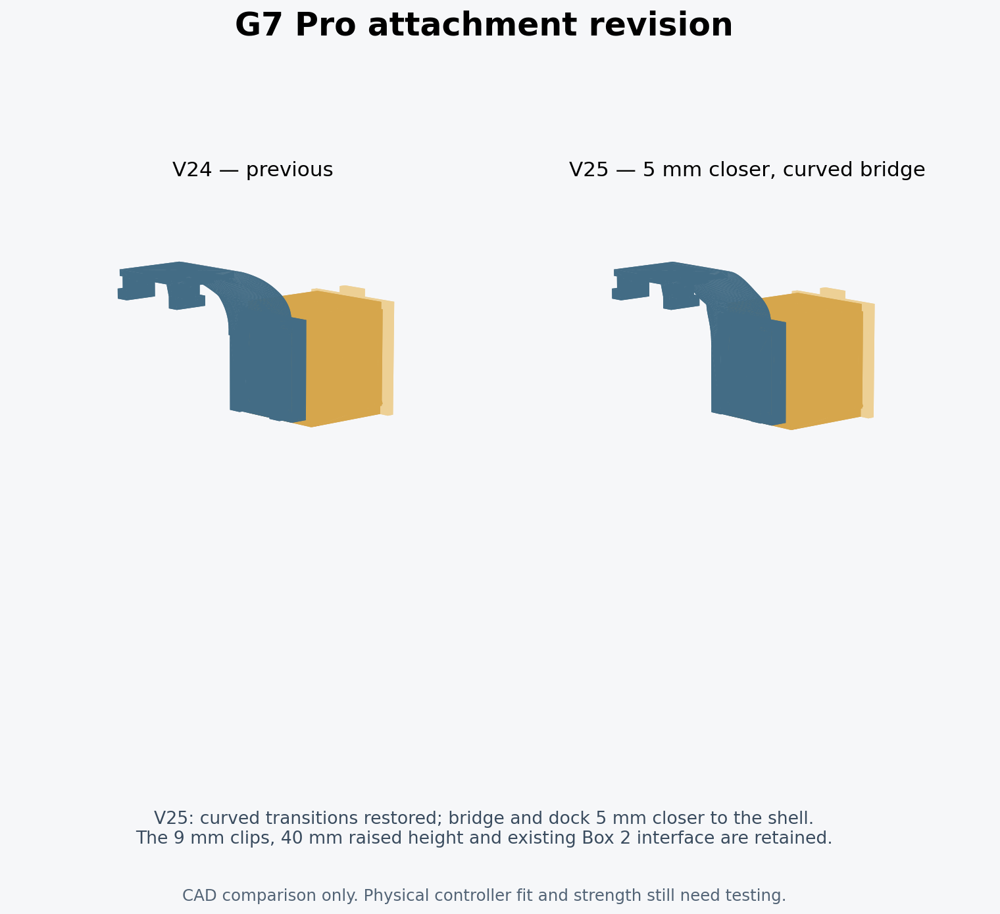

> V25 history. V26 recesses the receiver face 5 mm relative to the main base, rather than shifting the base and socket together. See [V26 revision](V26_REVISION.md).

# V25: curved bridge and dock 5 mm closer to the controller

V24's extra outward stand-off made the box stick out farther than the owner wanted. V25 restores curved transitions based on V23 and moves both the bridge and the complete receiver/box/key installation **5 mm inward toward the rear shell**. The 9 mm clips and 40 mm raised height are retained.

## Coordinates and geometry

Installed +Y points toward the controller bottom, and +Z points outward. All values are mm.

| Reference | V24 | V25 |
| --- | --- | --- |
| Top clip length | 9 | 9 |
| Dock raise relative to V23 | 40 | 40 |
| Outward stand-off relative to V23 | 8 | 3 |
| Receiver base Z | 31.7 | 26.7 |
| Receiver open end Y | 34.6 | 34.6 |
| Native box placement | [12.5, 24.2, 37.8] | [12.5, 24.2, 32.8] |
| Box reversal axis XY | [11.5, 21.4] | [11.5, 21.4] |

The controller-contact clips are imported from the V24 hook test mesh and preserved below Z=10.01. The upper wide cheek is reconstructed using the V23 outer/inner curve paths. Its outward coordinate eases inward with a smoothstep transition between the original Z=10 and Z=28; the top of the bridge is exactly 5 mm inward. This rebuilds and re-triangulates the curved polygon instead of warping existing mesh triangles. The clip root is unchanged at the start of the transition.

Two 3.7 mm-wide, 3.8 mm-deep curved structural links replace the old straight links, transitioning into the underside of the receiver. Their highest surface is Z=27.6, below the female channel floor at Z=29.1. They are permanent load-carrying parts, not removable print supports.

The entire receiver is translated without deforming its channel or key slot. Box 2, its lid, the key, the male coupon and the portable receiver remain geometrically identical to V23/V24. Existing printed components can be reused; only the attachment needs replacement.

## Evidence

`docs/validation_v25.json` records **94 CAD checks**, including unchanged clip contact surfaces, both 9 mm clip lengths, the retained 40 mm raise, both 5 mm inward offsets, watertight/connected solids, exact interface preservation, both USB orientations, insertion/removal paths and retention geometry. The raised male head remains about 2.83 mm outward of the revised hook's highest point; all modeled component pairs clear in the intended assembly and slide path.

The saved U1 project passed **84 project/slicing checks**. Both plates reopened and sliced with no plate-level warnings. The supported 3MF embeds the actual generated support toolpaths, checked against the current slice output. Thin normal/snug rectilinear supports are retained; there are no tree branches. The source STLs, assembly 3MFs, supported and editable projects, comparison and support preview are all included in the V25 ZIP.

## Physical check still needed

The revised curve follows the requested inward move, but no controller shell model or new physical fit measurements were supplied. Print the revised small hook/curve test before loading the full mount. Check that the closer curve and box clear the shell, rear buttons and cables, and that the clips seat without force. No load, fatigue or support-removal test has been performed.
