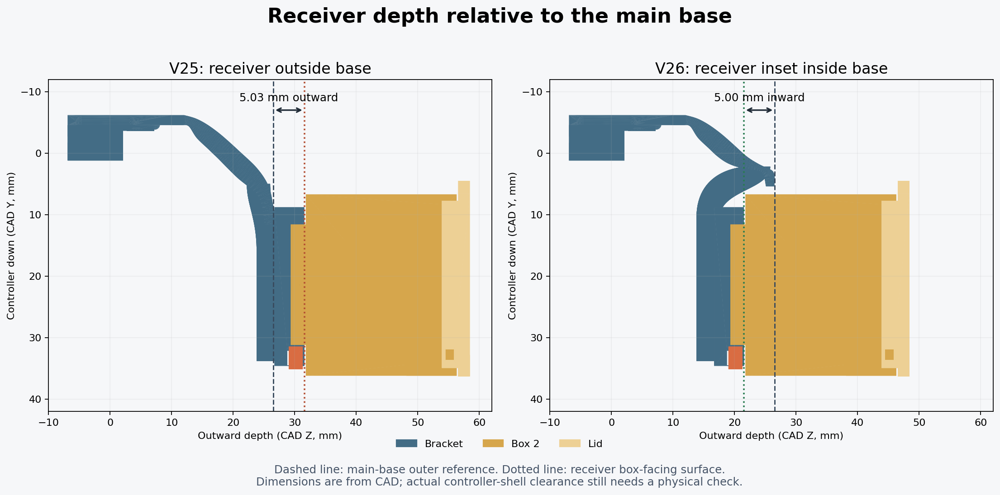

# V26: receiver inset relative to the main base

The owner clarified that the part holding Box 2 should sit about 5 mm inside the main base, like the recessed arrangement on V23. V26 defines that dimension between **the main base's outward-most reference surface and the receiver's box-facing surface**. It preserves the main-base depth from V25, rather than moving the base and receiver together.

## Coordinates

Installed +Y is toward the controller bottom; +Z is outward from the rear shell. All dimensions are mm.

| Reference | V25 | V26 |
| --- | --- | --- |
| Main-base outer Z reference | 26.5215 | 26.5215 |
| Receiver box-facing surface Z | 31.5500 | 21.5215 |
| Receiver relative to base face | 5.0285 outward | 5.0000 inward |
| Receiver base Z | 26.7000 | 16.6715 |
| Receiver center Y | 21.4 | 21.4 |
| Native box placement | [12.5, 24.2, 32.8] | [12.5, 24.2, 22.7715] |
| Top clip length | 9 | 9 |
| Dock raise relative to V23 | 40 | 40 |

The change moves the socket/box/key 10.0285 mm inward relative to V25, because that socket face previously sat 5.0285 mm *outside* the base reference. The new result is a 5 mm inward inset; the main base's outward depth is unchanged. V23 supplied the recessed-layout reference, not an exact 5 mm face-to-face dimension.

## Curved step and slide clearance

A simple receiver translation would put the box's front wall into the original upper bridge during insertion. V26 turns the positive-Y portion of the upper curve earlier, ending at Y=5.4 instead of about 11.6. The box's leading wall starts at about Y=6.6–6.7, leaving room to slide past. This adjustment does not alter the controller clip/root region.

Two curved structural links make the drop into the recessed socket. They descend below the enclosure rear surface by the leading wall and stay below the female channel floor in the docking area. These links are permanent bracket material, not disposable print supports.

The box, lid, locking key, dovetail coupon and portable receiver retain their V23/V24/V25 shapes. There is no scaling or reshaping of the sliding interface; existing printed box components can be reused. The 9 mm clips and 40 mm raised box position are retained.

## Validation

`docs/validation_v26.json` records **93 CAD checks**, including the measured 5 mm receiver-face inset, unchanged main-base depth, unchanged clip contact surfaces, both 9 mm clips, 40 mm raise, connected watertight solids, interface matching, both USB orientations, full insertion/removal paths and retention geometry. The earlier whole-module bounding-plane check is not appropriate for a deliberately inset receiver; the actual component-intersection and motion checks remain required and pass.

The U1 project passed **84 saved-project and native slicing checks**. Both plates reopened and sliced with no plate-level warnings. The Supported 3MF includes the exact generated support G-code. Thin straight normal/snug supports are retained, without tree branches.

No controller shell model or physical check of this new inset was available. The box now sits closer to the real shell, so verify shell, button and cable clearance before loading the mount. The small hook/curve test checks the revised upper shape but does not validate the full receiver/box installation. No load or fatigue rating is established.
