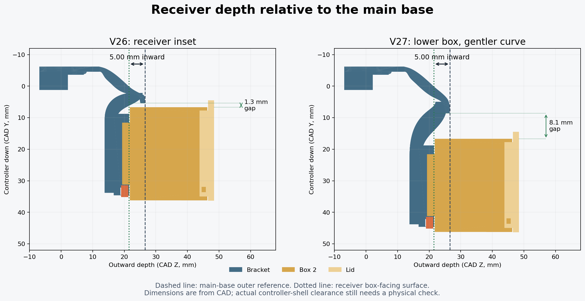

> V27 history. [V28](V28_REVISION.md) retains the same docking position with a more rounded, continuous curve.

# V27: lower box and more generous curve

The owner asked for the curve again and suggested lowering the box about 10 mm to leave slack for installation. V27 moves the **receiver, box, lid and key down 10 mm** from V26 and makes the curved transition longer and more gradual. It retains the **9 mm clips** and **5 mm inset of the receiver face relative to the main base**.

## Position and clearance

Installed +Y is controller down; +Z is outward. Values are mm.

| Reference | V26 | V27 |
| --- | --- | --- |
| Receiver center Y | 21.4 | 31.4 |
| Receiver open end Y | 34.6 | 44.6 |
| Native box translation | [12.5, 24.2, 22.7715] | [12.5, 34.2, 22.7715] |
| Height raised relative to V23 | 40 | 30 |
| Receiver face inset | 5 | 5 |
| Top clip length | 9 | 9 |
| Upper bridge end Y | 5.4 | 8.6 |
| Leading box wall Y, USB down/up | 6.7 / 6.6 | 16.7 / 16.6 |
| Upper-bridge-to-box Y clearance, down/up | 1.3 / 1.2 | 8.1 / 8.0 |

The larger upper-bridge clearance is a measured separation along Y, not a claim that every point in the intervening region is empty: the permanent curved links connect below the box's rear surface. Both complete insertion/removal paths are tested for actual solid interference.

## Curve changes

The main base retains the same outward reference Z=26.5215, and the socket face remains at Z=21.5215. Positive-Y compaction of the upper curve is reduced from 6.2 mm to 3.0 mm, giving a softer turn than V26. The structural links use longer Bezier curves from Y=5 to Y=22 and extend under the lowered receiver. Their upper faces descend below the box's rear surface before its leading wall, and remain below the female channel floor in the docking area.

Box 2, its lid, key, dovetail profile and standalone receiver do not change. Existing printed box components remain usable. The structural links are permanent parts of the mount; the slicer uses separate thin straight removable supports.

## Validation and physical check

The exported meshes passed **96 CAD checks**, including the exact 10 mm lowering, both 9 mm clips, unchanged clip contact surfaces, retained 5 mm receiver inset and main-base depth, minimum 8 mm upper clearance in both orientations, connected watertight solids, interface preservation, full insertion paths and key/stop retention geometry. See `validation_v27.json` for hashes and measurements.

The saved U1 project passed **84 project/slicing checks**, and both plates reopened and sliced without plate-level warnings. The Supported 3MF embeds the actual verified support toolpaths. The same Snapmaker PLA Basic Black / U1 0.4 mm settings and thin straight rectilinear supports are retained.

The geometry adds room to approach and slide the box. It does not loosen or scale the dovetail fit. No physical controller-shell scan or new print test was available, so confirm shell/button/cable clearance and fitting ease on the actual controller before loading it. The small hook/curve coupon does not test the full installed box position, and no load or fatigue rating is established.
