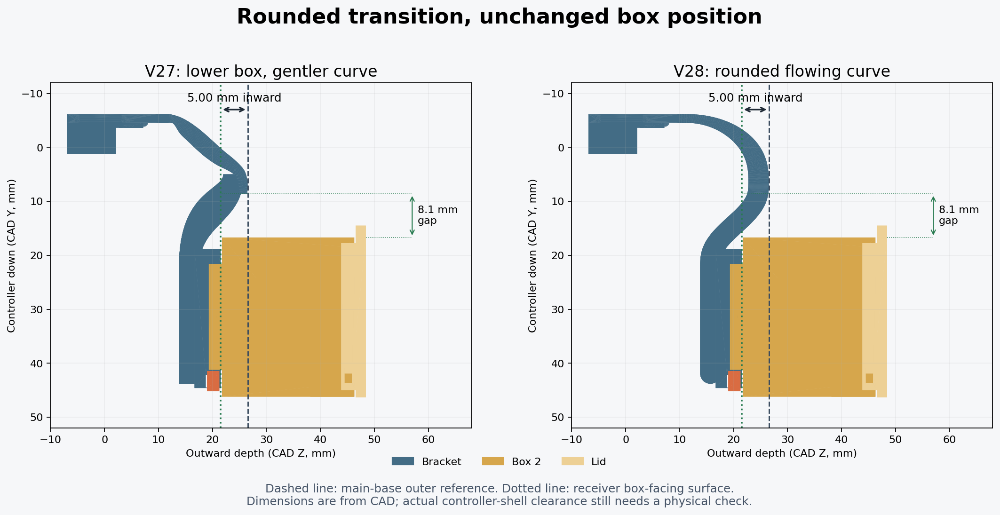

# V28: rounded, flowing transition

V28 addresses the owner's aesthetic feedback that the V27 curve looked awkward. The box, receiver and key stay at exactly the V27 position. The 9 mm clips, 5 mm receiver-face inset, 10 mm lowering from V26, and minimum 8 mm upper-bridge clearance are retained.

## Rounded construction

V27's independently shaped upper and lower profiles intersected near a pointed-looking end. V28 replaces them with swept circular bands sharing a common rounded crown:

- The wide upper bridge follows a quintic Bezier centerline, starting vertically from the unchanged clip root and arriving horizontally at the crown.
- The root radius tapers smoothly from 0.81 mm to 1.9 mm. This preserves the 1.62 mm clip-root profile and grows to a 3.8 mm crown.
- The lower return starts at the same crown with a horizontal tangent and zero endpoint curvature. A quintic smootherstep depth transition ends horizontally at the receiver support, eliminating the abrupt change at the straight section.
- A constant 1.9 mm radius gives the lower return a consistent 3.8 mm thickness measured normal to its centerline. The permanent links remain 3.7 mm wide across X.
- The upper band and lower return each use 64 sweep segments and 64-sided circular sections. Their rounded end caps replace the sharp-looking termination; this is a geometry change, not merely a smoothing effect applied to an image.

The main-base outward reference remains Z=26.5215, the receiver face remains Z=21.5215, and the receiver center stays Y=31.4. The link tail ends before the receiver's open end, preserving the same overall depth and docking end as V27. The curved links are permanent bracket structure, not removable supports.

## Compatibility and checks

The box, lid, key, male coupon and standalone receiver remain the same as previous versions. Existing printed Box 2 components can be reused. No dovetail scaling or clearance change is introduced.

The exported solids passed **97 CAD checks**, including unchanged controller-contact surfaces, both 9 mm clips, the 5 mm inset, V27 docking end and base depth, minimum upper clearance, both USB orientations and full insertion/removal paths. The seven models are connected watertight positive solids, and the receiver profile and retention geometry remain intact. See `validation_v28.json` for tested mesh hashes and measurements.

The saved U1 0.4 mm Snapmaker PLA Basic Black project passed **84 project/slicing checks**. Both saved plates sliced without plate-level warnings, and the Supported file contains the verified generated toolpaths. Thin straight normal/snug print supports are retained; no branches are added.

This revision changes the curved body near the controller while preserving the clip contact geometry. No physical print or controller-shell fit test was performed. Check the new curve against the shell, buttons and cables before loading the assembled mount; no strength or fatigue rating is established.
