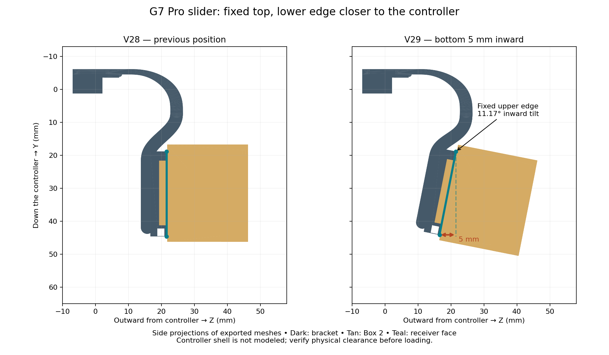

# V29: lower slider edge tilted 5 mm inward

The owner reported that the slider protruded too far from the controller and supplied a rear-view photo. V29 moves its lower edge toward the shell while holding its upper edge fixed. The photo indicates direction only; it cannot establish exact shell clearance.

Native coordinates: +Y is down the controller; +Z is outward. The receiver face upper edge is at Y=18.8, Z=21.5215 mm. Its face is 25.8 mm long. The rigid rotation about X is −asin(5/25.8) = −11.1745°. The lower face moves from Y=44.6, Z=21.5215 to approximately Y=44.111, Z=16.5215 mm. This is a 5 mm inward displacement, not a 5° tilt or a global scale change.

The receiver, installed box/lid and key rotate together. The box's outside corners move by different amounts because of their distance from the pivot. The upper face edge stays 5 mm inward of the main bridge's Z=26.5215 reference; the lower edge is 10 mm inward. The previous 10 mm lowering relative to V26 is retained in the receiver's local frame; its projection shifts slightly due to rotation.

The 9 mm top clips and wide rounded upper bridge stay fixed. Two permanent lower links are reshaped as smooth quintic curves into the tilted support floor. Their normal profile thickness remains 3.8 mm and their width 3.7 mm. These links are structural material, separate from removable print supports.

The unchanged Box 2, lid, key, standalone receiver and male coupon can be reused. Both box directions and their axial insertion paths pass collision checks. Only the full bracket needs reprinting for the geometry change.

The final seven exported STLs passed 99 CAD checks, including clip preservation, connected watertight solids, receiver interface, key engagement, both assemblies, insertion paths and the measured 5 mm displacement. The saved U1 PETG project passed 92 checks, including native reload, both slices, material settings and embedded support toolpaths. Reports: `validation_v29.json` and `../slicer/Snapmaker_U1_IEMAI_Matte_PETG_Black_0.4_V29/validation.json`.

OpenSCAD 2021.01 CGAL cannot reliably union the rotated imported receiver. `tools/build.sh 29` exports the hook, links and installed receiver separately, then performs a checked manifold3d union. No mesh repair changes are applied to the mating profile. Use this pipeline to reproduce the finished bracket.

Controller-shell clearance, installation access, trigger/button/cable clearance, PETG fit, flexure fatigue and strength still require physical testing. The computer checks do not replace these tests.
