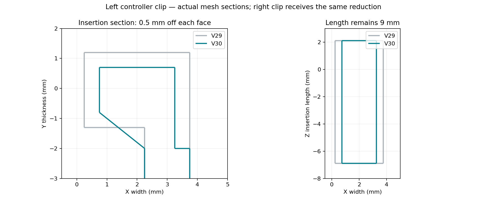

# V30: smaller insertion cross-section and easier-release PETG supports

The owner reported breaking clips when inserting them and breaking the bracket while removing supports. The final clarification was to retain the clip insertion length and reduce only the cross-section of the parts entering the controller.

## Clip measurements

For both tongues, 0.5 mm is removed from each opposing cross-section face. This reduces overall width and thickness by 1 mm, with centers retained:

| Measurement | V29 | V30 |
|---|---|---|
| Insertion width X | 3.5 mm | 2.5 mm |
| Insertion thickness Y | 2.5 mm | 1.5 mm |
| Insertion length Z | 9 mm | 9 mm |
| Left tongue X limits | 0.25–3.75 | 0.75–3.25 |
| Right tongue X limits | 19.25–22.75 | 19.75–22.25 |
| Both tongue Y limits | −1.3–1.2 | −0.8–0.7 |
| Both tongue Z limits | −6.9–2.1 | −6.9–2.1 |

Coordinates are in mm in the native design frame. The attachment roots behind Y=−2 stay unchanged. Short tapered connectors join the roots to the resized tongues. No scaling of the whole bracket, Box 2 or receiver is applied. The V29 slider tilt and rounded bridge remain. Existing box, lid and key can be reused.

## Support settings

| Setting | V29 | V30 |
|---|---|---|
| Top/bottom contact separation | 0.32 / 0.32 mm | 0.48 / 0.48 mm |
| XY clearance | 0.5 mm | 0.8 mm |
| Base line spacing | 3 mm | 4 mm |
| Top/bottom interface layers | 2 / inherited | 0 / 0 |
| Key top gap / interface | 0.24 mm / 1 layer | 0.48 mm / 0 layers |
| Overhang threshold | 30° | 45° |
| Brim object gap | 0.15 mm | 0.3 mm |

Straight normal/snug rectilinear supports remain. Removing dense interfaces and increasing separation favors peeling over underside finish. A rougher supported underside or local sagging is possible. The short test plate is intended to test both fit and support removal before the full bracket. No physical peeling or insertion-force measurement has been performed.

## Validation

The seven final meshes pass 103 CAD checks, including measured tongue bounds, unchanged 9 mm lengths, preserved roots, connected watertight solids, receiver geometry and both orientations/insertion paths. The saved PETG project passes 99 checks after native reload and slicing of both plates with no plate-level warnings. Both cached G-code files contain actual support paths and match the validated slices. See `validation_v30.json` and the slicer folder's `validation.json` for evidence and hashes.

The smaller cross-section has less material than V29; reduced insertion force should help avoid forcing the clips, but strength, retention, shell clearance and support-removal behavior still require a physical test. No load rating is established. Temperature and cooling settings remain the uncalibrated Generic-PETG-derived IEMAI starting profile from V29.
