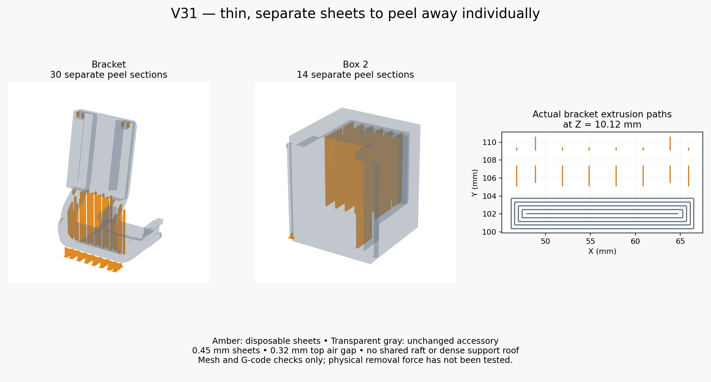

# V31: explicit single-bead peel sheets

The owner rejected the V30 supports and described the desired Vader back-cover supports as a bunch of thin layers that peeled off easily. The Vader project was not available; this revision is a new design based on that description, not a verified reproduction of the original support file.

## Accessory unchanged

All seven V31 accessory STLs are byte-identical to V30. The controller clips stay 9 mm long with a 2.5 × 1.5 mm insertion section, reflecting the requested 0.5 mm removal from each cross-section face. The receiver tilt, rounded curve, box, lid, key and fit surfaces remain unchanged. CAD source V31 imports the frozen V30 meshes; all dependencies are retained.

## New support construction

`tools/peel_sheets.py` intersects vertical rays with the already-oriented accessory geometry. It places separate 0.45 mm disposable walls in air below downward overhangs, with conservative neighboring-ray checks to avoid nearby solids. Sheets have a nominal 3 mm pitch; extra rows support the fine clips. Each strip is divided into at most 8 mm sections with 0.8 mm separation channels. Sheets end 0.32 mm below their ceiling; those starting above an accessory surface start 0.32 mm above their floor. Sheets reaching the bed receive individual 1.4 mm wide, 0.2 mm high feet where these do not intersect the model. There is no shared raft or dense support roof.

The sheets are checked watertight and added as disconnected disposable shells within the same print object. The accessory shell is not boolean-unioned with them. The native project retains all shells and their positions. Normal/manual mode with no enforcers suppresses automatic support generation; the validated G-code contains no generated Support-type paths. Every saved sheet/pad has actual thin extrusion paths in the G-code. Small sections under the key are short pads rather than tall walls.

Counts: hook test 8, male fit test 5, key 5 per plate, main bracket 30, Box 2 14. Lid and standalone receiver need none. Plate totals are 18 and 49. The old global support-gap/density fields do not set these explicit mesh dimensions.

## Validation and limits

110 CAD checks passed, including exact V30 mesh identity, the preserved clips, both box orientations and insertion paths. The native project passed 131 checks, including unchanged accessory surfaces, sheet shell counts/geometry, no sheet/accessory overlap, thin sheet paths on both plates and exact cached G-code. Both saved plates sliced without plate-level warnings in Snapmaker Orca 2.4.1. Reports: `validation_v31.json` and `../slicer/Snapmaker_U1_IEMAI_Matte_PETG_Black_0.4_V31/validation.json`.

A disconnected shell and air gap are deliberate: these supports are disposable print geometry. Keep each print object intact in Orca and preserve its orientation; do not split shells or move the sheets. The accessory-only STL does not contain this new support design. Use the 3MF as a project and re-slice if changing the plate contents.

No physical print, peel-force, fatigue or load test has been performed. Tall single-bead sheets may flex during printing, and the air gaps can leave sagged or rough undersides. The test plate should be printed before the full bracket. Remove one cooled section at a time while holding the nearby body; do not lever against the clips. The PETG profile remains the conservative, uncalibrated Generic-PETG-derived IEMAI starting profile from V29/V30.
