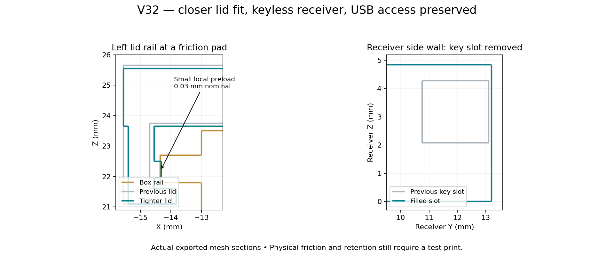

# V32: friction-fit lid and keyless receiver

The owner reported that the Box 2 sliding cap slid too easily and requested removal of the locking key and its holes. Inspection showed that the separate key fits the controller receiver, while the box/lid notches provide USB access. V32 removes the actual receiver key slot and printed key while retaining functional USB access and lid detent reliefs.

## Lid fit

The lid is rebuilt parametrically from the original V22 geometry, with a 0.15 mm inward shift of each side wall and capture lip. Nominal rail-side clearance falls from 0.35 to 0.20 mm. The roof and pull tab move down 0.10 mm, reducing roof-to-rim clearance from 0.25 to 0.15 mm; roof thickness remains 1.90 mm.

Three ramped friction pads per side are centered at local Y=−10, −3 and 4 mm. Each is 3 mm long, 0.55 mm high and projects 0.23 mm inward from the new wall. Given 0.20 mm nominal side clearance, the peak local preload is 0.03 mm. This is intentional small interference, not a promise of a measured fit. Snap-detent reliefs remain, as does the USB notch. The fitted box is unchanged, so the new lid can be tested on an existing Box 2 print.

The complete 35 mm lid withdrawal path is sampled every 0.25 mm. Contact is checked to stay inside the small pad preload regions and existing snap detents; there is no unexpected rigid-body collision. At the seated position the intentional pad overlap is about 0.131 mm³. At the far end of withdrawal the cap clears completely. Physical sliding force depends on printer tolerances and material and has not been measured.

## Key removal

The native receiver's transverse slot at Y=10.75–13.10, Z=2.08–4.28 mm is filled outside the unchanged dovetail channel. The same patch is installed in the tilted controller bracket. The box and its male docking rail are unchanged; they never had a matching transverse key hole. Six parts are exported: bracket, box, lid, receiver, male fit coupon and hook test. There is no V32 locking-key STL or key object on either plate.

The box/lid USB cutouts and lid snap-detent reliefs remain because they are not key holes. The controller clips retain the V30 insertion dimensions and 9 mm length. Slider position and tilt remain at V29. The union pipeline canonicalizes receiver coordinates to 0.00001 mm to avoid degenerate triangles caused by nearly coincident rotated float32 faces.

Without the key, the entire box-to-controller connection relies on the existing sliding friction; that docking fit has not been tightened. The tighter cap alone does not retain the whole box on the controller. Check keyless retention unloaded before installing the device. No holding-force or load claim is made.

## Printing and checks

The current U1/0.4 mm matte PETG project retains V31's explicit 0.45 mm peel sheets, with no dense support roof or shared raft. The filled receiver needs fewer support sections: bracket 26, box 14, hook test 8, male fit test 5. Lid and standalone receiver have none. Plate totals are 13 and 40; no key is printed.

82 CAD checks and 110 native project/slicing checks passed. Both saved plates reopened and sliced without plate-level warnings in Snapmaker Orca 2.4.1. Checks cover valid connected meshes, matching integrated/portable receiver geometry, filled slot probes, controlled lid preload, both box poses and insertion paths, actual sheet extrusions, saved settings and matching embedded G-code. Reports: `validation_v32.json` and the V32 slicer folder's `validation.json`.

Physical cap force, keyless docking retention, sheet removal, strength and fatigue remain unverified. Print only the lid first if testing cap fit; remove other whole objects and re-slice. The unchanged Box 2 can be reused. Retain the frozen previous versions for reverting the fit if needed.
