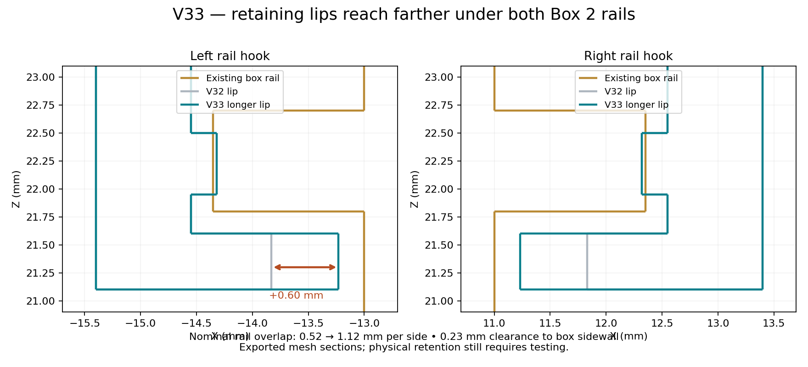

# V33: longer cap rail-retaining lips

The owner reported that the cap still slid off and asked for longer hooks around the side rails. V33 changes only the cap's inward-facing return lips, adding 0.60 mm on each side. Their reach is now 1.32 mm instead of 0.72 mm.

At the straight rail section, nominal under-rail overlap increases from 0.52 to 1.12 mm per side. The new left tip is X=−13.23 mm; the right tip is X=11.23 mm. Each retains 0.23 mm clearance from the box sidewall. Lip thickness stays 0.50 mm and the vertical gap below the rail stays 0.20 mm. V32's wall position, roof height, friction pads, USB access and snap-detent reliefs remain.

The model checks measure the new tips and sample the complete cap sliding path every 0.25 mm. Unexpected interference remains absent outside the intended friction-pad and detent regions. At a deliberate 0.30 mm outward lift, cap/rail geometric contact increases from about 2.746 to 5.782 mm³. This confirms engagement in the model, not a physical holding force. The longer lips improve capture against lifting off; axial slide-off behavior still depends on the retained friction pads and detents.

All five other parts are byte-identical to V32. The existing box can be reused, and only the cap needs reprinting. Keyless controller docking and its friction-based retention are unchanged.

The U1 0.4 mm Snapmaker PLA Basic Black project retains 220°C nozzle, 65°C bed, 0.16 mm layers and an 8 mm³/s flow limit. Eight individual thin-sheet sections now support the longer cap lips; no shared raft, dense roof or automatic support blocks are added. The project has 13 disposable sections on plate 1 and 48 on plate 2.

90 CAD checks and 112 project/slicing checks passed. Both saved PLA plates reopened and sliced without plate-level warnings in native Snapmaker Orca 2.4.1. Reports: `validation_v33.json` and `../slicer/Snapmaker_U1_PLA_Black_0.4_V33/validation.json`. Actual cap-sheet extrusion paths and the cached G-code are checked.

Open the 3MF as a project. Remove the other whole objects from plate 2 to print only the cap, keeping its support shells together, then re-slice. Cool fully before peeling one sheet at a time. Test the cap on the box without forcing it. Print tolerances, physical retention, removal force, strength and fatigue remain unverified.
