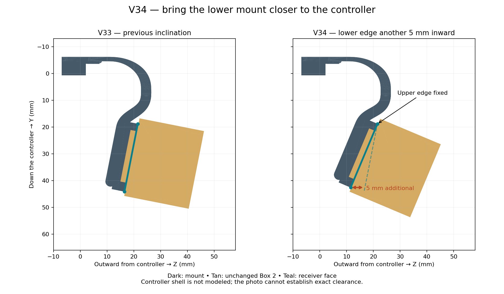

# V34: another 5 mm inward at the lower mount

The owner supplied a new photo showing a gap below the installed mount and requested about 5 mm more inclination toward the controller. V34 holds the receiver's upper face edge fixed and moves its lower face edge another 5 mm inward from V33.

## Placement

Native +Y is down the controller; +Z is outward from its back. The pivot stays at Y=18.8, Z=21.5215 mm. Receiver face length is 25.8 mm.

| Datum | V33 | V34 |
|---|---|---|
| Inward angle relative to upright V28 | 11.1745° | 22.8051° |
| Upper face Y / Z | 18.8 / 21.5215 | 18.8 / 21.5215 |
| Lower face Y / Z | 44.1109 / 16.5215 | 42.5832 / 11.5215 |
| Cumulative lower-edge inward shift from V28 | 5 mm | 10 mm |

Thus the new lower edge is 5 mm farther inward and approximately 1.528 mm higher than V33. The upward component follows from the rigid pivot; this is not a separate box-lowering change. The complete receiver, installed box and cap share the same rotation. The dovetail geometry remains unchanged.

The lower links are rebuilt as smooth quintic swept bands from the fixed upper crown into the new inclined floor. Their normal profile thickness remains 3.8 mm and width 3.7 mm. The upper rounded bridge and controller-contact hook are frozen V33 geometry. Clip length stays 9 mm, with the same reduced insertion cross-section.

Only the main mount STL changes. Box, longer-lipped cap, standalone keyless receiver, male coupon and hook coupon are byte-identical to V33. Existing prints of those parts can be reused. No key or new cap change is introduced.

## Printing and verification

The U1/0.4 mm Snapmaker PLA Basic Black project keeps 220°C nozzle, 65°C bed, 0.16 mm layers, four walls and 8 mm³/s maximum flow. Explicit 0.45 mm peel sheets are regenerated for the inclined mount. Counts remain 13 disposable sections on the fit plate and 48 on the complete plate, including eight under the unchanged cap lips.

91 CAD checks passed, including connected watertight meshes, measured extra 5 mm movement, fixed upper edge, preserved clips, unchanged reusable parts, matching integrated/portable receiver, both box orientations and sliding paths. 112 native project/slicing checks passed after reopening both plates in Snapmaker Orca 2.4.1 without plate-level warnings. Actual sheet extrusion paths and exact embedded G-code are checked. Reports: `validation_v34.json` and the V34 slicer folder's `validation.json`.

The photo is a direction reference, not a calibrated shell scan. Physical clearance, controller button/trigger/cable access, installation access and strength remain unverified. A nominal extra 5 mm is not proof that the gap is eliminated or that the mount can bear on the shell. Print only the mount from plate 2, retaining its sheets, and re-slice after removing the box/lid. Check unloaded before installing the device. Keyless docking still relies on the existing sliding friction.
