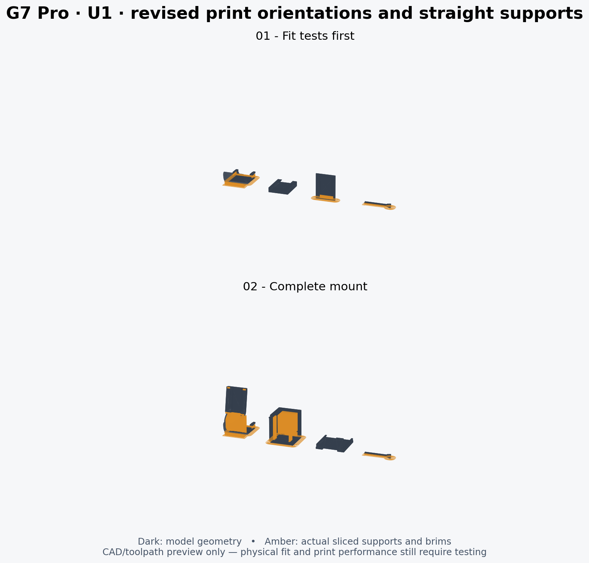

# V30 — U1 0.4 mm, IEMAI matte PETG black, top cover removed

Open `G7_Modular_v30_U1_0.4_IEMAI_Matte_PETG_Black_Supported.3mf` **as a project** in Snapmaker Orca 2.4.1 or newer. It includes the model placements, custom presets and cached support toolpaths. The file without `_Supported` is the editable unsliced project. No external support STLs are needed.

This is a conservative **starting profile**, derived from Snapmaker Orca 2.4.1's bundled Generic PETG and U1 presets. IEMAI's manufacturer page could not be accessed, and the spool temperature range was not available. The material name identifies the intended filament; the settings are not IEMAI-certified or physically calibrated. Check your spool label and adjust temperatures within its stated range before printing.

| Setting | Starting value |
|---|---|
| Machine / nozzle | Snapmaker U1 / 0.4 mm |
| Filament | IEMAI matte PETG, black, 1.75 mm |
| Build surface | Textured PEI |
| Nozzle | 245°C |
| Bed | 80°C first layer, 75°C thereafter |
| Chamber heat | Disabled; use without top cover |
| Layers | 0.16 mm; first layer 0.20 mm |
| Walls / infill | 4 / 25% gyroid; key 100% |
| Max volumetric speed | 4 mm³/s |
| Outer / inner walls | 30 / 45 mm/s; key 25 / 30 |
| Infill / top | 55 / 30 mm/s, also limited by flow |
| First layer / infill | 15 / 20 mm/s |
| Bridges | 18 mm/s |
| Part cooling | Off first 3 layers; normal 20–40%, overhang/bridge override 60% |
| Auxiliary / exhaust fans | 0% material setting |
| Support type | Normal, snug, straight rectilinear; no tree branches |
| Support spacing / interface | 4 mm / no dense interface layers |
| Support top / bottom gap | 0.48 / 0.48 mm |
| Support XY gap | 0.8 mm |
| Key support override | No interface, 4 mm support spacing, 0.48 mm top gap |
| Brim | 5 mm outer, 0.3 mm gap; none for lid/standalone receiver |

The stock U1 start/end G-code is retained, including its purge, nozzle cleaning and firmware macros. Fan or temperature changes during cleaning are not the normal part-printing settings. No active chamber heating is requested; removing the top cover is a physical step, not an action the 3MF can perform. Keep the printer away from direct drafts.

The official Generic PETG flow ratio (0.95) and stock retraction behavior are retained as starting values, not measured calibrations. No pressure-advance calibration is claimed. Use dry filament according to its label; popping or stringing warrants drying before tuning retraction.

## Easier support removal and clip fit

V30 removes the dense support interfaces, increases support top/bottom gaps to 0.48 mm, XY gap to 0.8 mm, and line spacing to 4 mm. The overhang threshold is 45°. Key overrides use the same gap and no interface. These changes reduce contact; they may leave sagging or a rougher supported underside. Actual peel force has not been measured.

Both controller insertion tongues shrink from 3.5 × 2.5 mm to 2.5 × 1.5 mm: 0.5 mm from each face of the cross-section. Their 9 mm insertion length is unchanged. Print the short hook test first. Reduced insertion force and retention cannot be guaranteed without testing on the actual controller.

Cool completely before support removal. Hold the root of each clip close to the support contact and peel in small sections. Cut stubborn support strands individually; do not bend a clip to snap off a large support block. The wider brim gap also makes the brim easier to separate. Permanent curved links are not print supports.

## Printing order

1. Verify the machine, nozzle, material and textured PEI surface selection. Confirm the nozzle and bed temperatures agree with the spool label.
2. Print plate 1 first: 9 mm hook test, receiver, male slider coupon and key. Check the clip on the controller and the sliding fit after cooling. Do not force the key or slider.
3. Inspect Preview and print plate 2: revised bracket, Box 2, lid and key. The bracket stands on its broad hook face; the box stands on its closed end; the lid lies flat; the key lies on its long side with sparse support pads. If reusing the existing box/lid/key, keep only the bracket and re-slice.
4. Let the plate and parts cool before removal. Peel the thin straight supports in sections. PETG can bond more strongly to its own supports than PLA: 0.48 mm separation and no dense interface favor removal but leaves a rougher supported underside. The supports are thin to aid removal; easy release is not physically verified. Leave the curved structural links intact.
5. Check the unloaded bracket against the controller shell, buttons and cable path before fitting the device. If it binds, stop and adjust based on the contact point. Do not heat or force it onto the controller.

If your build-plate manufacturer recommends a release layer for PETG, follow that instruction. Do not assume adhesion and release are identical to PLA. Review the key's flex before trusting it under load.

Both saved plates were reopened and sliced by actual Snapmaker Orca 2.4.1 with no plate-level warnings. The supported project embeds those exact G-code files. Estimated totals including supports/brims: fit plate about 52 minutes / 6.47 g; full plate about 2 h 33 minutes / 19.30 g. Estimates are not measured print results. See `validation.json` for 99 checks and file hashes.

Dark is model geometry; amber is actual support/brim extrusion. This render is a toolpath illustration, not a physical print result. Re-slice after any change; cached toolpaths describe the entire saved plate.
