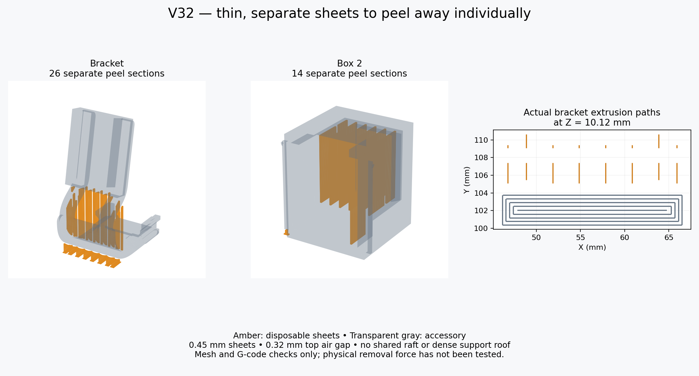

# V32 — individual peel-sheet supports for open-top U1 PETG

Open `G7_Modular_v32_U1_0.4_IEMAI_Matte_PETG_Black_Supported.3mf` **as a project** in Snapmaker Orca 2.4.1 or newer. This retains V31’s individual peel sheets with the updated lid and keyless receiver. The file without `_Supported` is the editable unsliced project.

## Thin disposable sheets

The supports are explicit 0.45 mm sheet meshes placed in air below overhangs, targeting one extrusion per sheet. They are nominally 3 mm apart, broken into sections no longer than 8 mm with 0.8 mm tear channels. The top air gap is 0.32 mm. A sheet starting above the accessory also has a 0.32 mm bottom gap. Bed-starting sheets have their own small 0.2 mm high feet, not a common raft. There is no dense interface roof. Small features use short pads of the same thickness rather than tall sheets.

These sheets are separate disposable shells inside each print object. The box is unchanged; the lid has a closer fit and the bracket/receiver key slots are filled. No locking key is included. Do not split the objects into shells or drop their shells onto the bed separately. Preserve their relative positions and the saved orientations. If printing only the bracket, remove the other whole objects and re-slice.

**Keep support mode Normal/manual, without painted supports or enforcer volumes.** The checkbox is on in this mode, but no extra automatic support blocks are generated. The validated G-code contains the explicit sheet extrusions and no generated `Support` toolpaths. Do not switch to Normal/auto or add another support system. The usual support-spacing/interface/gap fields are inactive for these sheets; their dimensions are in the mesh and `peel_sheets_manifest.json`.

The normal accessory-only STLs do not contain these sheets. The `custom_supports/` STLs are rebuild sources in print coordinates, not additional objects to drop onto the project. Everything required to print is already positioned in the 3MF.

## Machine and material

| Setting | Saved value |
|---|---|
| Printer / nozzle | Snapmaker U1 / 0.4 mm |
| Material | IEMAI matte PETG black / 1.75 mm |
| Surface / cover | Textured PEI / top cover removed |
| Nozzle | 245°C |
| Bed | 80°C first layer, 75°C thereafter |
| Active chamber heating | Disabled |
| Layer height | 0.16 mm; 0.20 mm first layer |
| Walls / infill | 4 / 25% gyroid; key 100% |
| Maximum volumetric speed | 4 mm³/s |
| Outer / inner walls | 30 / 45 mm/s; key 25 / 30 |
| Top / infill | 30 / 55 mm/s, also flow-limited |
| First layer / infill | 15 / 20 mm/s |
| Bridges | 18 mm/s |
| Cooling | Off first 3 layers; normal 20–40%; overhang/bridge override 60% |
| Auxiliary / exhaust material setting | 0% |
| Brim | Disabled; sheets have individual feet |

The stock U1 start/end G-code remains, including purge/cleaning operations and firmware macros. Physical cover removal is your step. Keep the open printer away from direct drafts. The official Generic PETG flow ratio of 0.95 and stock retraction behavior are starting values, not measured calibrations.

This profile is derived from Snapmaker's Generic PETG preset. IEMAI's temperature range was unavailable; verify it against your spool label. Dry the material according to its label if needed. Follow your plate manufacturer's PETG release-layer guidance. No IEMAI manufacturer validation, physical flow calibration or peel-force test is claimed.

## Tighter cap and key removal

The new lid walls/lips move inward 0.15 mm per side; its roof is 0.10 mm lower. Six small rail pads provide 0.03 mm nominal local preload. Print only the lid first to try it against your current Box 2: remove other whole objects from plate 2 and re-slice. Let it cool and do not force it if it binds. The USB-access notch and snap-detent reliefs remain.

The separate key actually locked the whole box onto the controller receiver. Its slot is filled in the new bracket/receiver; the key is absent from both plates. USB-access openings in the box and lid are retained because they are not key holes. The existing male docking rail is unchanged. Keyless docking relies on existing sliding friction, so a tighter lid does not secure the whole box to the controller. Test it unloaded before installing the device; no physical retention force is established.

## Test and removal

1. Print plate 1 first: short hook test, keyless receiver and male fit test. Check sheet removal and controller fit after cooling.
2. The clips retain their 9 mm insertion length and V30's 2.5 × 1.5 mm insertion cross-section. Do not force them onto the controller.
3. Let the part cool fully. Hold the body close to the section you are removing. Start at the free edge of one sheet and peel it individually, then move to the next. Use flush cutters on a stubborn strand instead of levering a group against a clip. Leave the structural curved links intact.
4. Print plate 2 after checking the test. It contains the keyless bracket, Box 2 and tighter lid. The existing Box 2 can be reused. Print the new lid for the closer cap fit and reprint the bracket if you want its old key slot filled.
5. Inspect the supported surfaces and unloaded fit before installing the device. Thin sheets and air gaps may leave rougher or sagged undersides. Physical strength, retention and removal ease remain unverified.

Plate 1 contains 13 disposable sections; plate 2 contains 40. No key is printed. Some are tiny support pads. Slicer estimates including supports: plate 1 **47m 26s / 6.06 g**; plate 2 **2h 31m 44s / 17.55 g**. These are estimates, not measured prints.

The saved project passed 110 checks. Both plates reloaded and sliced in native Snapmaker Orca 2.4.1 without plate-level warnings. Checks confirm separate sheets, no accessory overlap, saved accessory surfaces, actual sheet extrusion paths and exact embedded G-code. See `validation.json` for details and hashes. This does not prove physical print or removal performance.
