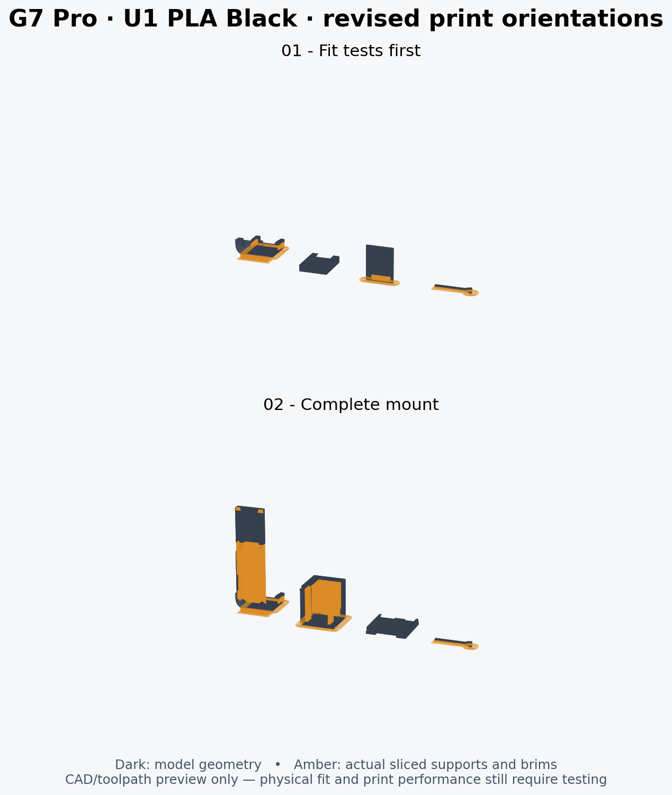

# Snapmaker U1 · 0.4 mm · Snapmaker PLA Black

Open **G7_Modular_v23_U1_0.4_Snapmaker_PLA_Black_Supported.3mf** in **Snapmaker Orca 2.4.1 or newer**, choosing **Open as project / Load configuration**. It contains the printer/material/process settings, object orientations, support overrides, and two plates. The Supported file includes the actual sliced support/brim toolpaths for both plates. Open Preview to inspect them before printing. The file without `_Supported` is the editable unsliced companion. If you change anything, slice again before sending it to the printer.



This uses the official **Snapmaker PLA Basic @U1** preset for regular PLA, with color set to black. If the spool label says Eco, Matte or SnapSpeed, select that matching material instead. All parts use filament 1, mapped to the first U1 tool; load black PLA there or remap to the tool holding it. No other filament or support material is required.

## Included plates

| Plate | Parts | Orca estimate |
| --- | --- | --- |
| 01 – Fit tests first | Short controller hook, standalone receiver, male dovetail coupon, locking key | 48m 10s; 7.99 g |
| 02 – Complete mount | Full mount, box, lid, locking key | 2h 23m 28s; 23.34 g |

Print plate 1 first. Check the actual hook on your controller, the dovetail fit and the key's release action before printing plate 2. These estimates include the slicer's modeled support/brim use; actual printer time/material can differ. The design has not been physically printed or fitted to a controller.

## Saved settings

| Setting | Value |
| --- | --- |
| Printer | Snapmaker U1, 0.4 mm nozzles |
| Material | Snapmaker PLA Basic, black |
| Bed | Textured PEI |
| Nozzle / bed temperature | 220°C / 65°C, including first layer |
| Maximum volumetric flow | 8 mm³/s (reduced from stock 15) |
| Layer height / first layer | 0.16 / 0.20 mm |
| Walls | 4, Arachne |
| Top / bottom layers | 6 / 5 |
| Infill | 25% gyroid; key 100% |
| Outer / inner wall speeds | 40 / 60 mm/s; key 25 / 30 |
| Infill / top surface speed | 80 / 35 mm/s |
| Support | Normal auto, snug, supports allowed on part surfaces too |
| Support contact gap | 0.20 mm Z, 0.35 mm XY |
| Brim | 5 mm outer brim, 0.15 mm gap; disabled on lid and standalone receiver |
| Scale / XY size correction | 100% / zero; elephant foot compensation 0.15 mm |
| Sequence / prime tower | By layer / disabled (single material) |

The mount and short hook coupon are rotated **90° about native X**, placing the broad outer-hook face on the bed rather than balancing on the hook tip. The mount has about **404 mm² of coplanar bed-facing surface**, versus 43 mm² previously, and prints about 81 mm tall with a 5 mm brim. Box 2 is rotated onto its broad closed end (about 588 mm² of coplanar bed-facing surface); the male fit coupon uses the same interface layer direction as the box. The lid remains broad-face down. The standalone receiver remains bottom-face down and support-free to keep its channel clean.

Supports may start on part surfaces, not only the build plate. This supports the upper interior wall of the upright box. The box's open side gives access to remove those supports before fitting the lid. Remove support residue from controller/dock contact surfaces carefully, and clear the transverse key opening. Neither the mesh geometry nor its scale has changed.

These choices follow an **18-candidate orientation comparison** of mount, box and short hook. [orientation_study.json](orientation_study.json) records the measurements; its initial comparison used build-plate-only supports, while the final project allows support on surfaces as well. No Vader 5 Pro reference project was available in this chat/workspace, so this is an independently checked removable-support setup rather than a claim to reproduce that file exactly.

**The locking key is on its long side with removable supports.** This places its flex gap vertically and avoids a 13 mm unsupported cantilever in the original flat orientation. Remove its support and brim carefully and inspect that the gap and tongue are free. The model itself is unchanged. PLA is more brittle than the PETG originally suggested for this flexure, so test insertion/release gently and inspect for cracking. This setup is not a strength or fatigue certification.

Check that the actual bed is textured PEI, the loaded tool is mapped correctly and supports release cleanly from contact surfaces. Keep the model scale at 100%; whole-part scaling changes the controller hook and box cavity as well as the dovetail. Physical controller/device fit remains unverified.

## Validation and reproducibility

Created and reopened with the official Snapmaker Orca **2.4.1** Linux release from:

- https://github.com/Snapmaker/OrcaSlicer/releases/tag/v2.4.1
- Printer/material base settings: that release's bundled `resources/profiles/Snapmaker`.

Both plates were sliced from the saved project with return code 0, no plate-level slicing warnings, and nonempty G-code. `validation.json` records both project SHA-256 hashes, 76 checks, saved/reloaded settings, geometry preservation and plate membership/clearance. No physical print or graphical UI inspection was performed. The Supported 3MF embeds both validated plate G-code files, including their actual support toolpaths. The companion unsliced 3MF excludes G-code. The support preview is rendered from those generated toolpaths and oriented meshes; it is not a screenshot of the slicer UI.

The CLI in 2.4.1 has inherited Bambu baseline/version handling: reopening its own project requires `--allow-newer-file`, and it reports missing optional BBL baseline paths and an empty bed-exclusion polygon. Validation confirms the full saved U1 configuration is retained and both plates slice successfully. The generator omits a redundant partial process-preset `wipe_tower_filament=0` field to avoid another 2.4.1 CLI null-pointer bug; prime tower stays disabled and the merged project retains the default. These are CLI workarounds, not printer G-code modifications. Manufacturer start/end/tool-change routines remain unchanged.

Using the repository's existing virtual environment and an installed Snapmaker Orca 2.4.1 runtime:

```bash
.venv/bin/python tools/create_snapmaker_orca_project.py \
  --resources /path/to/SnapmakerOrca/resources \
  --orca /path/to/snapmaker-orca \
  --workdir /tmp/g7-u1-project --validate
```

The executable can be a wrapper that provides your system's required libraries and `--datadir`; it must pass through the supplied arguments. The generator writes the unsliced project and its resolved preset JSONs, then reopens/slices it, exports the Supported project with cached G-code, and runs the validator. It leaves oriented intermediate STLs, logs and validation G-code in the scratch working directory. No Git worktree is needed. The printer profile JSON is primarily a resolved build input; use the 3MF to open the configured project.
