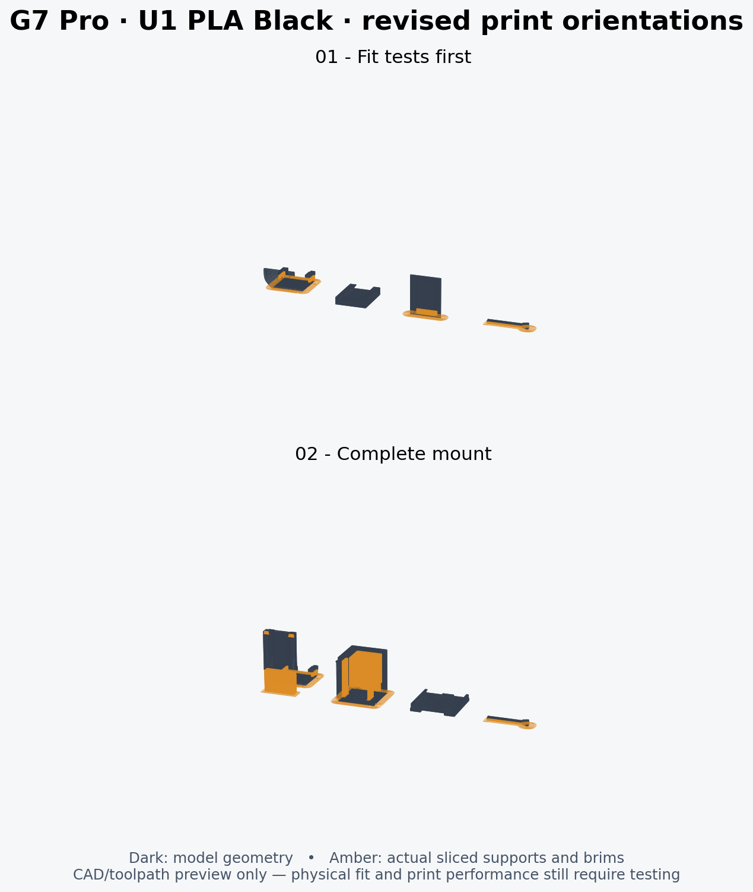

> V25 archive. The [V26 project](../Snapmaker_U1_PLA_Black_0.4_V26/README.md) has the receiver face inset 5 mm relative to the main base.

# V25 · Snapmaker U1 · 0.4 mm · Snapmaker PLA Basic Black

Open **G7_Modular_v25_U1_0.4_Snapmaker_PLA_Black_Supported.3mf** as a project in Snapmaker Orca 2.4.1 or newer. It contains the **curved bridge and dock moved 5 mm closer to the shell**, the retained **9 mm clips** and **40 mm raised height**, and **thin straight supports with no branches**, plus the actual sliced toolpaths. Open Preview before printing. The companion file without `_Supported` is editable and unsliced. Re-slice after any change.



| Plate | Contents | Estimated time / PLA |
| --- | --- | --- |
| 1 — fit tests first | 9 mm hook test, receiver, male dovetail coupon, key | 40m 58s / 7.04 g |
| 2 — complete mount | Raised attachment, box, lid, key | 2h 4m 1s / 20.76 g |

Print the 9 mm hook test first. The sides of the clips remain unchanged; 1 mm has been removed from their free ends. Test seating and retention on the real controller before relying on the complete mount. The box, lid and key are unchanged from V23. If you already printed those, select only the attachment and re-slice instead of printing the cached full plate.

## Saved settings

- Snapmaker U1, 0.4 mm nozzles, first tool/filament 1, regular Snapmaker PLA Basic colored black.
- Textured PEI; 220°C nozzle and 65°C bed; 8 mm³/s maximum volumetric flow.
- 0.16 mm layers, 0.20 mm first layer, four Arachne walls, 25% gyroid, key 100% infill.
- 40/60 mm/s outer/inner walls; key 25/30 mm/s. Manufacturer start/end/tool-change routines are unchanged.
- **Normal auto / snug, rectilinear supports.** Thin parallel base lines with 3.0 mm spacing, not tree branches or a cross-hatched grid.
- Support contact: 0.32 mm Z gap, 0.45 mm XY gap; 2 interface layers with 0.40 mm spacing. These should ease removal but may leave rougher undersides.
- Key: sparse normal pads, 1 interface layer, 0.40 mm interface spacing and a 0.20 mm top gap. Its flex gap stays vertical; remove its support and brim gently.
- Supports may start on part surfaces so the box's upper interior wall is supported. Remove those supports through its open side before fitting the lid.
- The lid lies broad-face down; the standalone receiver sits bottom-face down. Both are support-free. The mount and hook rest on the broad outer-hook face; box and male coupon stand on matching end faces.
- 5 mm outer brims, 0.15 mm brim gap; no brim on lid or standalone receiver. Scale stays 100% and XY size corrections remain zero.

The dock is now 3 mm outward relative to V23, down from V24’s 8 mm: 5 mm closer to the rear shell. The upper cheek is rebuilt with the V23 curve eased inward above the unchanged clip root, and the links beneath the receiver have curved transitions. The two curved arms connecting it to the hook are permanent structural parts, not print supports. [Installed geometry comparison and measurements](../../docs/V25_REVISION.md).

## Validation and rebuild

The source meshes passed 94 CAD checks. This saved project passed 84 settings, geometry, plate-layout and native slicing checks; both saved plates sliced without plate-level warnings. Supported-file G-code matches the validated outputs. See `validation.json` and `../../docs/validation_v25.json`. Neither physical fit of the revised clips nor support-removal force has been tested.

Source: official [Snapmaker Orca 2.4.1](https://github.com/Snapmaker/OrcaSlicer/releases/tag/v2.4.1) machine and PLA Basic profiles. This assumes regular PLA Basic; select the matching material if your spool is a different Snapmaker PLA variant, then re-slice.

Use the existing checkout and its virtual environment:

```bash
source .venv/bin/activate
./tools/build.sh 25
python tools/create_snapmaker_orca_project.py --design-version 25 \
  --resources /path/to/SnapmakerOrca/resources \
  --orca /path/to/snapmaker-orca --workdir /tmp/g7-u1-v25 --validate
```

The executable may be a wrapper providing the local runtime libraries and data directory. The CLI uses `--allow-newer-file` to read its own exports because of an inherited legacy version constant. Its optional BBL baseline lookup, empty exclusion polygon and headless thumbnail diagnostics do not invalidate the verified settings or successful slice results. No graphical UI inspection or physical print was performed. The support preview is rendered from the actual support toolpaths.
