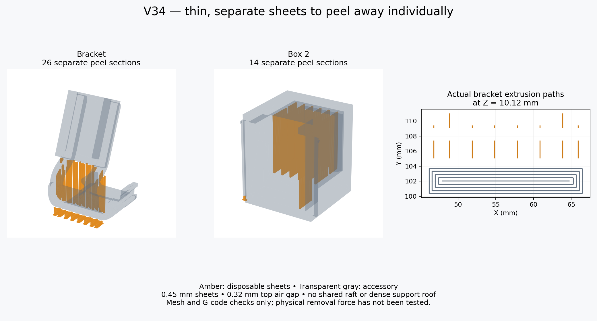

# V34 — Snapmaker PLA Basic Black, U1 0.4 mm

Open `G7_Modular_v34_U1_0.4_Snapmaker_PLA_Black_Supported.3mf` **as a project** in Snapmaker Orca 2.4.1 or newer. It includes the U1 machine preset, PLA material preset, part placements, thin peel sheets and actual cached toolpaths. The file without `_Supported` is editable and unsliced.

V34 tilts the mount's lower receiver edge another 5 mm toward the controller, keeping the upper edge fixed. Only the controller mount needs reprinting. The existing box and longer-lipped V33 cap can be reused. All five other part STLs are byte-identical to V33. No key is printed; USB access and the 9 mm clips remain.

| Setting | Saved PLA value |
|---|---|
| Printer / nozzle | Snapmaker U1 / 0.4 mm |
| Material / color | Snapmaker PLA Basic, 1.75 mm / black |
| Surface / cover | Textured PEI / top cover removed |
| Nozzle | 220°C, first and subsequent layers |
| Bed | 65°C, first and subsequent layers |
| Active chamber heating | Disabled |
| Layers | 0.16 mm; first layer 0.20 mm |
| Walls / infill | 4 / 25% gyroid |
| Outer / inner walls | 40 / 60 mm/s |
| Infill / top | 80 / 35 mm/s, also flow-limited |
| First layer / infill | 20 / 25 mm/s |
| Maximum volumetric speed | 8 mm³/s |
| Cooling | Official PLA cooling; fan off for first layer, normal min/max 100% |
| Brim | Disabled; sheets have individual small feet |

The material derives from the official `Snapmaker PLA Basic @U1` preset bundled with Snapmaker Orca 2.4.1. Black color and the conservative 8 mm³/s flow cap are set explicitly. Stock U1 start/end G-code and purge/cleaning behavior remain. Temperatures and fan changes during cleaning are distinct from part-printing settings. These settings have not been physically calibrated on this spool.

## More inward receiver inclination

The receiver tilt is now 22.81° inward, up from 11.17°. The lower face edge moves another 5 mm inward (10 mm cumulative from the upright V28 position); its upper face edge stays fixed. Lower structural links are reshaped into the new receiver pose, without changing the mating profile. Shell, button and cable clearance cannot be confirmed from the photo: test the unloaded mount first.

To print only the new mount, remove the box and lid objects from plate 2, retain the complete mount object with its disposable sheets, and re-slice. The cap still has the V33 longer rail-retaining lips and eight support sections, but it does not need reprinting for this change.

## Thin peel sheets and printing

Explicit 0.45 mm disposable sheets are already included as separate shells inside each print object. They retain V31/V34's 0.32 mm top gap, nominal 3 mm pitch and short independent sections. Keep each whole object intact and in its saved orientation. **Do not split shells or switch Normal/manual to automatic supports.** No additional support blocks are generated; the ordinary support-gap/density fields do not control the explicit mesh sheets.

Plate 1: hook test, keyless receiver and male docking fit test. Plate 2: keyless bracket, Box 2 and tighter lid. The first plate has 13 disposable sections, the second 48. To print only the revised mount, remove the box and lid objects from plate 2 and re-slice. Do not print stale full-plate cached toolpaths after changing the plate contents.

Print the short fit tests before the full assembly: PLA fit and flexibility can differ from PETG. Let the parts cool, hold the body close to each support section, and peel one sheet at a time. Cut a stubborn strand instead of levering against a clip. Do not force a binding clip or lid. Thin sheets favor removal but can leave rough or sagged undersides. Physical removal ease is unverified.

The keyless docking connection retains the previous sliding clearances and relies on friction; the tighter cap does not secure the entire box to the controller. Test the unloaded dock before installing the device. No physical retention force, strength or fatigue life is established.

## Validation

Both plates reopened and sliced in actual Snapmaker Orca 2.4.1 without plate-level warnings. The project passed **112 checks**, including saved PLA settings and cooling, actual heating commands, saved accessory surfaces, separate sheets with no accessory overlap, actual sheet extrusions and exact embedded G-code. See `validation.json` for the project hashes and details.

Estimated totals including disposable sheets: plate 1 **37m 28s / 6.59 g**; plate 2 **2h 5m 4s / 19.14 g**. These are slicer estimates, not measured print results.

Rebuild using `tools/create_snapmaker_orca_project.py --design-version 32 --material pla` with the usual resources, Orca and workdir arguments. V34 defaults to PLA; specifying `--material pla` makes that choice explicit.
